# Ночь: карта — куда развивать память сейчас

> Собрано из 7 файлов · 2026-10-11 18:25 · `tools/telegram/bundle-md.mjs`

## Оглавление
1. [OVERVIEW](#overview) — `docs/02-project/core/01-brain/01-overview/05-brain-direction/questions/2026-10-11-how-memory-grows/OVERVIEW.md`
2. [ROADMAP](#roadmap) — `docs/02-project/core/01-brain/01-overview/05-brain-direction/questions/2026-10-11-how-memory-grows/maps/ROADMAP.md`
3. [FORKS-REGISTER](#forks-register) — `docs/02-project/core/01-brain/01-overview/05-brain-direction/questions/2026-10-11-how-memory-grows/questions/FORKS-REGISTER.md`
4. [02-fable-adversarial-now.analysis](#02-fable-adversarial-now-analysis) — `docs/02-project/core/01-brain/01-overview/05-brain-direction/questions/2026-10-11-how-memory-grows/analyses/w5-links/02-fable-adversarial-now.analysis.md`
5. [02-first-heartbeat.design](#02-first-heartbeat-design) — `docs/02-project/core/01-brain/01-overview/05-brain-direction/questions/2026-10-11-how-memory-grows/analyses/w4-deepen/02-first-heartbeat.design.md`
6. [01-final-critic.analysis](#01-final-critic-analysis) — `docs/02-project/core/01-brain/01-overview/05-brain-direction/questions/2026-10-11-how-memory-grows/analyses/w6-gate/01-final-critic.analysis.md`
7. [MINDMAP.mermaid](#mindmap-mermaid) — `docs/02-project/core/01-brain/01-overview/05-brain-direction/questions/2026-10-11-how-memory-grows/maps/MINDMAP.mermaid.md`


---

<a id="overview"></a>
## OVERVIEW
> Источник: `docs/02-project/core/01-brain/01-overview/05-brain-direction/questions/2026-10-11-how-memory-grows/OVERVIEW.md`

# 🧭 ОБЗОР темы: куда развивать память СЕЙЧАС, чтобы она начала себя отыгрывать

- **Status:** draft · **Owner:** jenya.stasik@gmail.com · **Date:** 2026-10-11 (ночь)
- **Потребитель:** владелец утром (30 секунд) + лид следующей сессии · **Поглощает:** ничего (вид над домом; истина в `analyses/`, `maps/`, `questions/`)
- Дом: `docs/02-project/core/01-brain/01-overview/05-brain-direction/questions/2026-10-11-how-memory-grows/`

## Что это (в одной мысли)
Карта из 8 ветвей (101 запись в графе: 96 живых узлов + 5 слитых дублей), которая считает, какой следующий шаг даёт памяти шанс начать кормить саму себя. Ответ ночи: сначала прочитать то, что ты и так пишешь шлюзу, а потом запустить маленькое «сердцебиение».

## Зачем
Две недели мы шлифуем замок на пустом хранилище: в памяти 0 записей, а бумаги, по исторической оценке августа, примерно в 14 раз больше кода. Нужен шаг, после которого память что-то возвращает.

**Высота (⭐ главное, не теряем):** память — это **конструктор для ИИ** (принципы → паттерны → системы), а не база задач. Её рост — **метаморфоза**: вопрос → идеи и мнения агентов → решение с «почему» и условием пересмотра. Сама эта ночь и есть первый ручной прогон такой метаморфозы: вопрос «как растёт память?» → 8 ветвей → развилки → решение-черновик. Запуск и рост идут **в совокупности, не очередью**: этапы 0 и 1 параллельны, а цикл роста в доках продолжается, даже пока мозг не запущен.

## Что уже сделали
5 волн, около 25 прогонов агентов (волна 1 `analyses/w1-altitude/`, ствол `analyses/w2-trunk/`, 8 ветвей `analyses/w3-breadth/`, углубление `analyses/w4-deepen/`, связи и очерёдность `analyses/w5-links/`). Сходятся: нужен замкнутый круг «записать → прочитать → родилась новая запись», конструктор и линзы подождут. Спорят: (1) кто первый, дела владельца или читатель над логом шлюза (критик нашёл, что корм уже лежит в шлюзе: 13 712 сообщений); (2) «вопрос» это заметка или новый тип; (3) «память = индекс над логом» или отдельное хранилище отобранного, это решает только владелец. Честно: все агенты одной семьи моделей, их согласие не доказательство. Единственный независимый факт ночи (проба читателя) дал «около 4 из 10», ниже нашего порога 5.

## Карта: корень и 8 ветвей
Корень: «что память должна вернуть раньше всего, чтобы в неё стало выгодно писать?». Светофор = готово ли сегодня.
- 🟡 B1 Корм: код есть, ждёт твоих рук и привычки вести дела
- 🟡 B2 Чтение обратно: поиск есть, «первого чтения» ещё не было
- 🟢 B3 Позвоночник решений: по коду хватает трёх записей (проверено валидатором в /tmp, живым мозгом НЕ проверено)
- 🟡 B4 Связи: три нужных ребра готовы, люди и глубокая карта ждут
- 🔴 B5 Пол и власть: стирания в мозге нет, нужны три «двери» до первой записи
- 🟡 B6 Автозахват: читатель идёт вперёд, пишущий хук заморожен
- 🔴 B7 Линзы и время: живёт один узел, остальное позже
- 🔴 B8 Конструктор: заморожен, пока нет живого слоя под ним

Слепые зоны: другой читатель (топик 92 не видит записей топика 56) · пульс памяти (жива ли она) · цена каждого хода · карта ночи сама забьёт первые поиски.

## Куда СЕЙЧАС
**Этап 0 (до 14 октября): проба читателя + фильтр секретов.** Почему: единственный шаг, которому не нужен запуск мозга, и он даёт чтение уже сегодня. Поправка Fable: фильтр должен стоять ДО модели (пароли из лога уже прошли через неё), адрес сообщения пока никто не умеет находить, в логе пробы не должно быть текста. Как проверим: по 10 пунктам ты ставишь «открыто / закрыто / не напоминать»; ≥5 «открыто» значит читатель наш корм. Оговорки: «не напоминать» ≠ «это личное/чужое» (это отдельный сигнал согласия V7); 10 пунктов отбирала та же модель, что их оценивает.
**Исполнитель фильтра секретов:** пока НИКТО — без кода фильтра нет. Это задача builder'а по твоему «строй» (регэксп по строкам БД до модели). До фильтра повторную пробу НЕ запускаем. ⚠️ В твоих сообщениях шлюзу открытым текстом лежат пароли серверов и строка подключения RabbitMQ — они уже прошли через модель при пробе; **рекомендую сменить эти пароли**. В файлах значений нет (проверено).
**«Адрес, не копия» — где текст всё ещё копируется:** trace пробы (`docs/_log/2026-10-11-night-memory-map/`, вне git) · ответ тебе в Telegram (оседает в логе шлюза) · payload первых записей мозга. Это осознанные копии, не скрытые.
**Этап 1 (до 18 октября): запуск и сердцебиение.** Пять записей, затем первое чтение ДО START (не вместо него, твой навигатор с ⭐ остаётся). Засчитываем, только если чтение родило новую запись. Идёт рядом с этапом 0, не очередью.

## Этапы 0–4
0 читатель и пол · 1 запуск, 5 записей, первое чтение · 2 неделя 1 (до 25 октября): корм, решения, чтение шире · 3 пол и тонкости (стирание, остывшее) после 26 октября · 4 заморожено: конструктор, линзы-как-данные, люди.

## Как ложится на V1–V7
- V1 Читаемость: укрепляет (дешёвое чтение), но потолок 12 строк теряет «почему»
- V2 Тождество: не трогаем
- V3 Доверие: напряжение, адрес без расшифровки и «4 из 10» не равно доказательству
- V4 Витальность: укрепляет, дела остывают, а не удаляются
- V5 Суверенность: напряжение, адрес привязан к базе шлюза
- V6 Реляционность: три ребра готовы, остальное позже
- V7 Согласие: 🔴 проба прочитала твои сообщения до вопроса «можно?», а защита от чужих данных только фильтр

## Открытые развилки
Владельцу три вопроса, подробнее в `questions/FORKS-REGISTER.md`:
- 🔴 Двери и три записи: «всё, что запишем в неделю 1, навсегда; пишем без имён; да на три записи?» и где они лежат (дефолт: личное, не скрытое). Ещё: запускал RUNBOOK?
- 🟡 По 10 пунктам: открыто / закрыто / не напоминать, и где ты ведёшь дела сейчас
- 🟡 «Отыгрывать себя»: окупаться, кормить себя или описывать себя? Дефолт: кормить себя
Операционные: часовой пояс (обязателен), два «да» (М7а, Д1). В очереди ещё 14 развилок с дефолтами.
🟢 Идём без вопроса: одна и та же запись про память в личной области.

## Что заморожено и почему
Автозахват-хук, стирание в мозге, люди, линзы-данные, конструктор: каждому нужен живой слой под ним (гардрейл «слой N+1 после живого N»).

**Не тронуто, ждёт слоя N+1 (узлы на карте есть, не потеряны):** п.8 слой людей · п.9 хранение/удаление по категориям и источникам · п.10 задачи по разным проектам · п.11 умные фильтры · п.13 луп с одной глобальной целью · п.14 линзы, живущие в памяти · п.18 системы с ролями поверх памяти.

## Статус
draft → после финального критика (SHIP-AFTER-PATCH, патчи 1/3/4/5 внесены) и холодного читателя (первый шаг назвал верно, понятность 3/5). Виды перегенерированы: `node maps/rank.mjs && node maps/render.mjs` (0 сирот).


---

<a id="roadmap"></a>
## ROADMAP
> Источник: `docs/02-project/core/01-brain/01-overview/05-brain-direction/questions/2026-10-11-how-memory-grows/maps/ROADMAP.md`

# ROADMAP — этапы углубления (генерируется)

- **Status:** generated · **Источник:** `maps/MINDMAP.graph.jsonl` (payload.stage/score — считает `maps/rank.mjs`) + `maps/stages.json` (условия) · **Генератор:** `maps/render.mjs` — не править руками.
- Функция: балл = разблокирует × код(1|0.3) × чтение(1|0.5) × руки владельца(1|0.7|0.4); слой N+1 = 0. Этапы 2–3 считаются в мире ПОСЛЕ запуска мозга (руки=1).

## Этап 0 ★ ШАГ СЕЙЧАС — Проба читателя + пол (фильтр ДО модели)

- **Срок:** до 2026-10-14 · **Руки:** владелец: по 10 кандидатам метка открыто / закрыто / не напоминать + одно слово «где ведёшь дела сейчас» + факт «запускал RUNBOOK?»
- **Условие перехода:** 2026-10-14: (1) пол: фильтр секретов и пересланного стоит ДО передачи текста в модель (не только до выдачи); пересланное отсекается по метаданным; trace хранит только адреса, без содержимого. (2) Адрес: gw:topicN/mID пока НЕ резолвится (без chat id неоднозначен) — шаг 0 идёт с явным ограничением «source в мозг не писать», пока нет алиаса чата (gw:<chatAlias>/tN/mID) или таблицы резолва. (3) Владелец поставил по 10 кандидатам три метки; ≥5 «открыто» → читатель = основной путь корма; 3–4 → гибрид с диктовкой; <3 «открыто» → вернуться к диктовке B1; «закрыто» шумом НЕ считается; «не напоминать» ≥3 = V7-сигнал (читатель лезет, куда не просили). Нет ответа владельца = читатель не доказан, шаг 1 всё равно идёт, трек Б = бумага. Этап 0 и трек Б идут в одной сессии параллельно, не очередью (п.24).
- **Заморожено до этого этапа:** любая запись контента в мозг; пишущий хук (B6b); всё на брейн-запуске; запись source с адресом gw:… до резолвера

| Узел | балл сейчас | балл после запуска | pays_off |
|---|---|---|---|
| `B6/reader-over-log` Шаг 0: читатель по адресу над логом шлюза (read-only) | 4.9 | 7 | 2026-10-14: владелец поставил по каждому из 10 кандидатов одну из трёх меток (открыто / закрыто / не напоминать) и назвал, где ведёт дела сейчас; ≥5 «открыто» = читатель основной путь корма; 3–4 = гибрид с диктовкой; <3 «открыто» = вернуться к диктовке B1; «не напоминать» ≥3 = V7-сигнал (читатель лезет, куда не просили); «закрыто» не считается шумом. Нет ответа = читатель не доказан, шаг 1 всё равно идёт (Fable A4/A5) |
| `B6/reader-secret-filter` Пол читателя: фильтр секретов и пересланного ДО модели | 1.2 | 1.2 | фильтр работает ДО модели: на 234 сообщениях пробы вырезает 100% строк с паролями/токенами и 100% пересланного чужого (по метаданным) ещё до отправки в LLM; выдача и trace содержат только адрес+обезличенную строку, без содержимого; проверено глазами владельца на 10 кандидатах (2026-10-14) |

## Этап 1 — Запуск и первое сердцебиение (R1–R5 + первое чтение)

- **Срок:** до 2026-10-18 · **Руки:** владелец: вечер на RUNBOOK + «да» на семя/decision/двери (иначе честно «трек Б = бумага»)
- **Условие перехода:** 2026-10-18: лид начал сессию с find открытых ДО START (рядом, не вместо: навигатор с ⭐ остаётся), назвал ≥1 запись, которой нет в START, И чтение родило ≥1 новую запись (критерий сердцебиения: не «лид вызвал find», а «чтение породило запись»); задача-проверка R5 поднялась сама. Записи R3–R5 лежат в области personal (видны в find) — meta включается, когда поедет ночная карта (снятие противоречия F10).
- **Заморожено до этого этапа:** расширение ядра связей, автозахват-журналы, B7, B8, всё что не нужно для R1–R5

| Узел | балл сейчас | балл после запуска | pays_off |
|---|---|---|---|
| `B3/question-node` Вопрос как узел (note, status:open) | 0.8 | 2 | find(preset:open) вернул ≥1 вопрос «как должна расти память?» из мозга (2026-10-18) |
| `deepen/first-read` Первое чтение: find open → find обратного ребра → read R4 depth 2 | 0.8 | 2 | до 2026-10-18 одно засчитанное чтение |
| `deepen/seed-r3` R3: семя-вопрос note kind:question status:open | 0.7 | 1 | — |
| `deepen/decision-r4-r5` R4 decision(derived_from R3, prediction, check_date) + R5 task проверки | 0.7 | 1 | — |
| `deepen/blocker-decision-banned` ПРОТИВ/блокер: протокол п.3 запрещает decision в неделю 1 | 0.7 | 1 | — |
| `B1/dictate` Диктовка «запомни…» своих дел | 0.4 | 1 | S1: >=10 задач на >=4 днях за 7 дней; из них src_owner>=3 (иначе привычки диктовать нет) |
| `deepen/backlog-r1r2` R1–R2: смоук-дело + стартовый бэклог (шаг 6.2, 6.9) | 0.4 | 1 | 2026-10-13 morning вернул ≥1 дело без записей этого дня |
| `B1/backlog-seed` Стартовый бэклог: 5–10 висящих дел в день 0 | 0.2 | 0.5 | D+1: утренний find(morning) вернул >=1 дело при 0 записей, сделанных в этот день; S3-кандидат назван владельцем |
| `B5/floor-k4` Пол К4: список «никогда» и по каждому пункту — кодом или дисциплиной | 0.31 | 0.45 | реестр ≥7 пунктов К4, у каждого колонка «держит»; ≥1 пункт «держит никто» превращён в код или в явное принятие риска владельцем (2026-10-18) |
| `B6/msg-address` Адрес сообщения шлюза (T0) | 0.3 | 0.3 | к 2026-10-18 тест brain: record с source.ref=gw:topic56/m8404 проходит, а сырой chat id отвергается |
| `B5/inline-door` Дверь «inline»: всё, что запишем в неделе 1, стереть можно только переписью журнала | 0.21 | 0.3 | решение записано в протокол: «неделя 1 = навсегда, пока нет by-ref» ИЛИ «стирание = офлайн-процедура владельца с журналом и бэкапами»; сверено владельцем (2026-10-18) |
| `deepen/doors-yes` Шаг 5а: три двери B5 одной фразой владельца | 0.21 | 0.3 | строка «Двери: …» в GATE-7days База до первой записи (2026-10-12) |

## Этап 2 — Неделя 1: корм, позвоночник, чтение широкое

- **Срок:** до 2026-10-25 (D+7) · **Руки:** агент; владелец только диктует/закрывает дела
- **Условие перехода:** 2026-10-25: GATE-7days: ≥1 прогноз решения проверен задачей из мозга; ≥3 «ответа ≠ START»; ни одной утечки секрета/3-го лица из читателя.
- **Заморожено до этого этапа:** hard_erase, граница власти, push-линзы, люди — до отметки D+7

| Узел | балл сейчас | балл после запуска | pays_off |
|---|---|---|---|
| `blind/other-reader` Другой читатель: пишет один топик, читает другой | 3 | 3 | 1 решение записано в топике 56, прочитано find из другого топика (92/проектный) и в выводе есть то, чего в START того топика нет |
| `B2/why-walk` Обход «почему»: read по derived_from/motivated-by | 0.8 | 2 | 2026-10-25: read(decision, preds=[derived-from,motivated-by]) вернул ≥2 корня-вопроса; лид объяснил решение по ним |
| `B4/edge-core` Ядро связей: in-scope + derived-from + motivated-by | 1.5 | 1.5 | после первых 3 задач у каждой есть in-scope и source; у 1 решения есть motivated-by; read(depth=1) их показывает (2026-10-18) |
| `B4/cross-project-tasks` Задачи разных проектов + привязка к источникам | 1 | 1 | 3 реальные задачи ≥2 проектов с source, find(scope) показывает каждую в своём проекте (2026-10-18) |
| `B6/tool-journal` Лог «что выполнено» = журнал шлюза (п.5) | 1 | 1 | к 2026-10-25 B2 отвечает «что делал агент вчера» по адресам unit_event без копирования payload |
| `B1/project-prefix` Дела разных проектов в одном списке | 0.4 | 1 | D+7: в export >=2 разных префикса проектов; >=1 вид сверх начального списка предложен через вопрос владельцу (тип = тропа) |
| `B2/first-read` Первое чтение: открытые вопросы ДО START (рядом, не вместо) | 0.4 | 1 | 2026-10-18: лид начал сессию с find, вывод ≤12 строк (presets.ts:138 cap) содержит ≥3 вопроса с id, которых нет в START |
| `B3/genealogy` Генеалогия: почему задан вопрос (п.16) | 0.4 | 1 | пересажены все 31 вопрос генеалогии + 5 F-вопросов, ни один не потерян (счёт до/после) (2026-10-25) |
| `B3/decision-derived` Решение: decision + derived_from + условие пересмотра | 0.4 | 1 | первое решение в мозге отвечает на «почему?» через read depth 2 без открытия md (2026-10-18) |
| `B3/prediction-check` Прогноз + дата проверки (неделя 1, вместо «суда») | 0.4 | 1 | в утро check_date владелец/лид увидел задачу проверки в morning и закрыл её фактом (сбылось/нет) (2026-10-25) |

## Этап 3 — Пол и тонкости чтения (после D+7)

- **Срок:** не раньше 2026-10-26 · **Руки:** агент + решения владельца по F2/согласию
- **Условие перехода:** событие: hard_erase в brain пройден тестом (или явно отложен владельцем) И ≥1 живой возврат остывшего/«ждёт тебя»; тогда разрешён взгляд на этап 4.
- **Заморожено до этого этапа:** слой N+1 (этап 4)

| Узел | балл сейчас | балл после запуска | pays_off |
|---|---|---|---|
| `blind/self-observe` Само-наблюдение памяти: пульс, журнал чтений, счётчик цены | 0.9 | 0.9 | к D+7 есть три числа: дней жив / чтений за день / ходов с find; и ≥1 чтение помечено «изменило действие» |
| `B7/meaning-log` git log для смысла: хронология решений | 0.6 | 0.6 | после ≥3 decision в мозге: ответ «что решили за неделю и на чём» получен одним чтением; ~2026-10-25 |
| `B2/waits-for-you` Реестр «ждёт тебя» (F5: владелец в курсе) | 0.24 | 0.6 | 2026-10-25: владелец получил одно сообщение «ждёт тебя: N» из find и ответил хотя бы на 1 |
| `B2/smart-filters` Умные фильтры и срезы (п.11) | 0.24 | 0.6 | 2026-10-25: ≥2 живых среза (по проекту и по давности) используются в чтении, без правки find |
| `B4/cross-links` Поперечные связи: about / informed / example / blocks | 0.5 | 0.5 | ≥5 поперечных рёбер между узлами РАЗНЫХ проектов; read находит связь за ≤1 запрос (2026-10-25) |
| `B6/idem-chain` Сквозная идемпотентность по message_id | 0.5 | 0.5 | к 2026-10-18 тест: хук дважды на один message_id -> dedup:true, один акт |
| `B1/tails` Хвосты: «Записать как дела? 1) 2)» | 0.2 | 0.5 | доля «да» >=50% на D+3 и D+7 (лид считает по транскриптам); src_offer не заменяет src_owner |
| `B1/close-loop` Закрытие дел: done / dropped по слову | 0.2 | 0.5 | S2: >=4 задач в done за 7 дней; вечерний дайджест показал >=1 залежавшееся >7 дн |
| `B3/ideas-variants` Идеи и варианты от агентов | 0.2 | 0.5 | ≥2 агентских варианта под одним вопросом в мозге, один стал cold без удаления (2026-10-25) |
| `B3/supersession` Коррекция: supersedes, старое не стирается | 0.2 | 0.5 | первая коррекция решения в мозге: обе версии читаются, старая superseded (2026-11-01) |
| `B5/erase-in-brain` hard_erase в @ff/brain: seam есть в engine, в brain нет | 0.31 | 0.45 | есть SPEC hard_erase для brain с решением inline vs by-ref и тест: стёртая запись не отдаётся find/read, tombstone по canonical_id сохранён (2026-10-25) |
| `B4/edge-as-memory` Ребро как память (V6): паспорт, свежесть, целостность | 0.3 | 0.3 | тест: retract узла → его рёбра видны как dangling/retracted и не попадают в read-вид; stale ребра считается (2026-10-25) |
| `B5/principal-collapse` V3: все агенты пишут одним принципалом — «кто сказал» не восстановить | 0.3 | 0.3 | до первой записи выбран носитель авторства (pack на привязку / author-поле в payload с пометкой «заявление» / принять и жить): зафиксировано в протоколе; проверка — 3 записи от лида и критика различимы в read (2026-10-18) |
| `B6/turn-act` Ход агента как один акт (T0) | 0.3 | 0.3 | к 2026-10-25 за 3 дня >=80% ходов топика 56 имеют ровно один turn-акт (проверка: счёт актов vs messages direction=in) |
| `B6/erase-gate` Гейт hard_erase: что T0, что T2 | 0.3 | 0.3 | к 2026-10-25 спека hard_erase в brain принята; до этого хук пишет только T0/T1 (проверка: ни один label не содержит текста сообщения) |
| `B6/manual-ledger` Ручной захват сейчас: ledger и хендоффы | 0.3 | 0.3 | к 2026-10-18 импорт ledger в мозг одним проходом (по w1 §3.3) даёт >=30 записей с живыми link-адресами |
| `B4/one-way-door` Односторонняя дверь: имена только в payload | 0.21 | 0.3 | тест: person с именем → erased → в журнале, id, рёбрах, source.ref и label имени нет; граф связен (2026-11-01) |
| `B5/consent-use` Согласие V7: use_consent ≠ read_consent | 0.21 | 0.3 | до появления первой записи о третьем лице: решено, где живёт use_consent (на ребре referent? в policy?) и что агент делает без него (2026-11-08) |
| `B2/push-lens` Push-линза: система сама выдаёт контекст | 0.12 | 0.3 | 2026-10-25: шлюз вклеил в промпт хода результат lens с ≥1 открытым вопросом; manifest хода это показывает |
| `B2/resurface` Возврат остывшего (V4 в чтении) | 0.12 | 0.3 | 2026-11-01: вечерний дайджест вернул ≥1 вопрос, забытый >14 дн, и владелец его закрыл или ре-открыл |
| `B5/authority-f2` Граница власти (F2): что агент меняет сам, что только владелец | 0.12 | 0.3 | путь «владелец подтвердил proposed» пройден вживую 1 раз; бюджет ≤5 дел/неделя записан; 2 недели спустя дел не больше, чем владелец прочёл (2026-11-01) |
| `B2/criterion` Критерий «цикл живёт»: ответ ≠ START | 0.15 | 0.15 | 2026-10-18: в хендоффе строка «чтение дало N вопросов, из них M новых относительно START», и чтение родило ≥1 новую запись (критерий сердцебиения по Fable: не «лид вызвал find», а «чтение породило запись») |
| `B4/tree-part-of` Дерево: part-of как скелет майнд-мапа | 0.15 | 0.15 | один срез part-of от узла-проекта отдаётся одним read; сверка с папками docs/ даёт <20% расхождений (2026-10-25) |
| `B5/copies-map` Карта копий: журнал, 14 бэкапов, зеркало, torn-*, outbox, транскрипты шлюза | 0.15 | 0.15 | таблица «где лежит копия payload» + для каждой: стирается кодом / руками владельца / не стирается; проверена на тестовой записи (2026-10-25) |
| `B6/hook-site` Где живёт хук: промпт, SDK или settings | 0.15 | 0.15 | к 2026-10-18 один эксперимент: тестовый PostToolUse/Stop хук в settings.json проекта срабатывает (или нет) в ходе под шлюзом |
| `B1/week1-fence` Забор недели 1: чего НЕ класть | 0.06 | 0.15 | стоп-кран D+1/D+3/D+7: 0 попаданий имён/секретов в export; нарушение = провал независимо от S1-S3 |
| `B2/question-type` Тип question (type-def candidate) | 0.06 | 0.15 | 2026-10-18: find{type:u:question,status:open} возвращает ≥3 записи без text-хака |
| `B3/opinions-passport` Мнение агента с паспортом (разведка, не голос) | 0.06 | 0.15 | у одного решения в мозге ≥3 ребра-мнения с разными confidence и ≥1 «против» (2026-10-25) |
| `B3/fork-triage` Развилка = вопрос kind:fork + триаж | 0.06 | 0.15 | за неделю ≤5 развилок дошли до владельца, ≥80% правок прошли без дела (прогноз F2) (2026-10-25) |
| `B1/system-feed` Корм не от владельца: импорт промптов | 0 | 0 | нет пользы владельцу: НЕ засчитывать в S1 (в gate считаются только type=task, status=active) |
| `B2/proto-layer` Протокол-слой: «первым вызови find» | 0 | 0 | 2026-10-18: слой в топике 56 активен (lens manifest содержит его id) и агент первым ходом вызвал find |
| `B6/transcript-addr` Адрес в транскрипт Claude (скоропортящийся) | 0 | 0 | к 2026-10-18 решено: либо адресуем только БД шлюза, либо владелец продлевает хранение транскриптов (одна настройка) |
| `B6/voice-dup` Дубль голосовых: P-2 не влит | 0 | 0 | до 2026-10-25: P-2 влит владельцем ИЛИ голосовые исключены из хука; проверка по seen_updates на повторы voice |

## Этап 4 — ЗАМОРОЖЕНО: слой N+1 (конструктор, линзы-данные, люди, retention/trust-политики)

- **Срок:** нет даты — по событию · **Руки:** —
- **Условие перехода:** гейт «слой N+1 только после живого N»: каждому узлу нужен один живой прогон слоя под ним (этап 3 закрыт), только тогда балл ≠ 0.
- **Заморожено до этого этапа:** всё этапа

| Узел | балл сейчас | балл после запуска | pays_off |
|---|---|---|---|
| `B4/tags-categories` Категории и теги | 0 | 0 | решено одно из трёх представлений и записано decision; 1 фильтр «по тегу» отдаёт ожидаемое (2026-10-25) |
| `B4/deep-mindmap` Максимально глубокий майнд-мап (вид-срез) | 0 | 0 | генератор выдаёт MINDMAP-вид из jsonl без ручной правки; у владельца ≤30 сек до картины (2026-11-01) |
| `B4/people-layer` Слой людей: отдельный подграф знаний | 0 | 0 | после запуска B5-двери: 1 узел person создан, erased-акт стирает payload, рёбра и id остаются целы (тест) (2026-11-01) |
| `B5/retention-data` Retention как данные: класс хранения по категории/источнику/плагину (п.9) | 0 | 0 | политика retention записана записью в мозге и читается агентом; для 1 источника прогон «удалить через N дней» на тестовой записи (2026-11-08) |
| `B5/trust-policy` Доверие на запись и политики как данные (10-10 п.9 и п.4) | 0 | 0 | 1 политика (trust топика 56) лежит записью sys-типа и агент её читает; изменение — только через proposed + владелец (2026-11-08) |
| `B7/lens-as-record` Линза = узел-рецепт (п.14), версия = новый узел | 0 | 0 | 2026-10-18: ≥1 запись-линза в мозге, прочитана read() и исполнена; при правке появилась @2, @1 цела |
| `B7/presets-as-lenses` Пресеты morning/evening/open → линзы-данные | 0 | 0 | после 7 дней жизни B1: пресет используется ≥3 раза и потребовал правки порога (STALE_DAYS) — тогда данные > код |
| `B7/type-views` Интерфейс подстраивается под тип (10-10 п.6) | 0 | 0 | когда появится ≥2 типа с живыми записями (task + question): один вид на тип открыт ≥1 раз; не раньше недели 2 |
| `B8/wave-cycle-pattern` Паттерн №1: цикл волны линз с критиком | 0 | 0 | первая запись-паттерн по АДРЕСУ (ссылка на правило/скиллы, не копия) + 1 прогон, где лид стартует сессию с чтения памяти (2026-10-25) |
| `B8/principles-floor` Принципы и пол в коде | 0 | 0 | К4 отвечен владельцем и записан как decision (2026-10-18) |
| `B8/type-trail` Тип = тропа (type-def candidate) | 0 | 0 | type-def u:question status candidate записан в мозг и 1 запись прошла не в raw (2026-10-18) |
| `B8/predicate-trail` Предикат = тропа (predicate-def) | 0 | 0 | predicate-def candidate «unlocks» заведён ИЛИ осознанно отклонён (motivated-by достаточно) (2026-10-25) |
| `B8/packs` Пакеты pack:<id> — словари паттернов | 0 | 0 | ≥2 реальных типа-тропы созрели и собраны в один pack-манифест (бумага) (2026-11-15) |
| `B8/prompt-layers-bridge` Мост: Claude Code как прототип → R1 промпт-слои | 0 | 0 | 7-дневное shadow-окно R1: diff=0 на живых ходах (2026-10-25) |
| `B8/system-node` Система = узел (пакеты×область×роли×цель×процесс×линзы) | 0 | 0 | first-system-loop описан как 1 узел со связями и переживает экспорт в md без потерь (2026-11-15) |
| `B8/first-system-loop` Первая система: луп «развивать память» (п.15) | 0 | 0 | старт сессии = чтение «открытые вопросы» из памяти ДО START-NEXT-SESSION (рядом, не вместо: навигатор с ⭐ остаётся) (2026-10-18) |
| `B8/universality` Универсальность и plug-in/маркетплейс (п.1) | 0 | 0 | второй человек/система подключили один пакет без правки ядра (не раньше 2027 (триггер, не дата)) |


---

<a id="forks-register"></a>
## FORKS-REGISTER
> Источник: `docs/02-project/core/01-brain/01-overview/05-brain-direction/questions/2026-10-11-how-memory-grows/questions/FORKS-REGISTER.md`

# Реестр развилок «Как должна расти память?»
- **Status:** draft · **Owner:** jenya.stasik@gmail.com · **Date:** 2026-10-11
- **Потребитель:** владелец (утро) + лид следующей сессии · **Поглощает:** ничего (это ВИД над `questions/*.question.md`, не второй дом истины)
- **Вопрос-цель:** какие развилки ночи требуют именно владельца и как спросить за 1 минуту голосом? Ответил: 3 вопроса ниже.
- **Правило F5:** владельцу ≤3 вопроса с дефолтом; остальное = очередь, не спрашивается, пока он не возразит. Оговорка critic: «ок» по дефолту это подпись, не голос; поэтому односторонние двери в топ-3.
- **Этапы** (сверено с `analyses/w5-links/01-rank-and-stages.analysis.md`; считает `maps/rank.mjs`, текст — `maps/ROADMAP.md`): колонка «Этап» ниже — старая шкала Э0–Э3. Соответствие: **Э0** (до первой записи) = этап 0 (проба читателя + пол) и двери/пол этапа 1 · **Э1** (сердцебиение) = этап 1 · **Э2** (D+7) = этап 2 · **Э3** (позже) = этапы 3 и 4 (4 = заморожено, слой N+1).

## ТОП-3 для владельца (ответ: «ок» или слово)

**1. Старт записи (двери + три первые записи).** Q-F8 + Q-F9 · 🔴
Вопрос: «Всё, что запишем в первую неделю, останется навсегда, без имён и только с твоего слова; плюс да на три первые записи (вопрос "как расти памяти", решение "читаем открытые, не START", проверка 18 октября) с исключением из запрета на decision. Ок?»
Дефолт: ок на всё.
Если иначе: «нет» на двери = не пишем, пока стирание не в коде; «нет» на записи = мозг только с делами, решения остаются бумагой (B3).
Заодно закрывает К0 (первая запись-рост = «как расти памяти») и К4 (пол).
Хвост (Fable, снимает противоречие F10 vs R3–R5): «записи про память R3–R5 лежат в `personal` (видны в find) или в `meta` (скрыты)?» Дефолт: `personal` сейчас, `meta` — когда поедет ночная карта (~80 записей).

**2. Что у тебя открыто из прочитанного? (переформулировано по Fable: чтение уже сделано, спрашиваем не «можно ли»)** Q-F7 · 🟡
Вопрос: «Я уже прочитал твои сообщения за 14 дней (V7: ты не успел сказать "можно" — это подпись, а не голос; секреты в них были, но в записи не ушли). Вот 10 пунктов с адресами. По каждому одно слово: открыто / закрыто / не напоминать. И где ты сейчас ведёшь дела? Плюс: запускал RUNBOOK (да / нет / застрял на шаге N)?»
Дефолт: нет ответа = читатель не доказан, шаг 1 всё равно идёт, трек Б остаётся бумагой.
Как читать ответ: «закрыто» это не шум; шум = «не напоминать»; ≥3 «не напоминать» = читатель лезет, куда не просили. ≥5 «открыто» → читатель основной корм; 3–4 → гибрид с диктовкой; <3 → диктовка.
Если иначе: без ответов пользы сегодня не будет, пока ты сам не запустишь RUNBOOK и не накормишь мозг. Заодно закрывает К1 (живые моменты «вот бы помнило») на реальном материале.

**3. «Отыгрывать себя» это что?** Q-F6 · 🟡
Вопрос, одно слово: «окупаться, кормить себя (чтение рождает запись) или описывать себя?»
Дефолт: кормить себя. Следствие (Fable): критерий сердцебиения = чтение родило ≥1 новую запись, а не «лид вызвал find».
Если иначе: «описывать себя» двигает «конструктор» раньше чтения, а это слой N+1 без живого N.

**Условия шага 0, сняты Fable (не вопросы владельцу, а блокеры до выдачи):** фильтр секретов стоит ДО модели (A1) · trace хранит только адреса без текста, а адрес `gw:topicN/mID` сегодня не резолвится, поэтому `source` в мозг не пишем, пока нет алиаса чата или таблицы (A3) · чтение стоит ДО START, а не вместо (навигатор с ⭐ остаётся) · шаг 0 и трек Б идут в одной сессии параллельно, не очередью.

**Операционные, одной строкой (Q-F11):** часовой пояс (М7б, **обязателен, без него гейт не стартует**; машина в PDT -0700) · М7а «да» · Д1 «да» (фикс дубля не летит). Плюс факт: «запускал RUNBOOK? да / нет / застрял на шаге N».

## Очередь с дефолтами (не спрашиваем; владелец может возразить)
| id | вопрос простыми словами | кто решает | дефолт | свет | блокирует | файл |
|---|---|---|---|---|---|---|
| F1 | Нужно описание роста или чтобы рост начался в живом мозге? | владелец | уже ответил п.24/п.15 («расти сейчас»): записи в форме record + пересадка в день запуска | 🟡→🟢 | Э1 нет | [01](01-what-is-track-b.question.md) |
| F2 | Что меняет сам агент, а что только владелец; что считать «делом»? | владелец (вето) | правила роста и пол только владелец; дело = ≥2 из 4 И тест 7 дней; ≤5 дел | 🟡 | Э2 | [02](02-power-boundary-and-triage.question.md) |
| F3 | Нужны ли новые типы записей? | агенты + critic | нет; тип после 3-го ручного повтора | 🟢 | нет | [03](03-process-shape-no-new-types.question.md) |
| F4 | «Голосование» агентов: счёт или разведка? | владелец (его слово) | разведка; все «за» → проверка «до абсурда»; прогноз + дата | 🟡 | нет | [04](04-votes-as-scouting.question.md) |
| F5 | Как держать владельца в курсе? | агенты, вето владельца | этот реестр + OVERVIEW ≤30 с + ≤3 вопроса | 🟢 | нет | [05](05-owner-awareness-budget.question.md) |
| F10 | Куда класть записи про саму память, чтобы не забили дела? | агенты + critic | **уточнено (Fable w5):** R3–R5 (3 первые записи) в `personal`, чтобы чтение их видело; область `meta` (скрыта в `find`) включается, когда поедет ночная карта (~80 записей) | 🟢 | Э0 (правило в протокол) | [10](10-meta-area-before-first-write.question.md) |
| К1 | 1-3 живых момента «вот бы помнило» | владелец | агент предложит 3 из твоего журнала (см. Топ-2), ты поправишь | 🟡 | нет | START §4 |
| К2 | «Ничего не терять» = адрес или копия? | владелец | адрес, не копия (решение INTAKE) | 🟢 | Э3 | START §4 |
| К3 | Доверие агенту: один раз или растёт из твоих «да»? | владелец | растёт из истории (частично решено п.9) | 🟢 | Э3 | START §4 |
| К5 | Конструктор сначала для тебя одного или сразу для систем? | владелец | для тебя одного | 🟢 | Э3 | START §4 |
| R0 | Ратифицировать видение «память = конструктор» | владелец | оставить draft, без ратификации | 🟢 | нет | START §4 |
| W5 | Вносить ли шаги 5а/5б/6.9-6.11 в RUNBOOK | лид, по «строй» | да, после ответов Топ-1 | 🟡 | Э1 | [02-first-heartbeat §5](../analyses/w4-deepen/02-first-heartbeat.design.md) |
| B6/B1 | Автозахват (адрес) не ждёт ли «живой B1»: порядок, это круг? | critic перепроверяет | перевернуть: читатель и адрес без руки владельца | 🟡 | Э1 | [03-fable §3](../analyses/w4-deepen/03-fable-blindspots.analysis.md) |
| G2 | Поправки владельца из `feedback-*.md` как под-узел корма | агенты | кандидат, не новая ветвь | 🟢 | нет | [03-fable G2](../analyses/w4-deepen/03-fable-blindspots.analysis.md) |

В очереди: **14** (владелец по дефолту: F1, F2, F4, К1, К2, К3, К5, R0; агенты/лид: F3, F5, F10, W5, B6/B1, G2). Операционные Q-F11 не считаются: они отдельной строкой выше.

## Противоречия, пойманные при сборе
- F1 числится открытым, но владелец фактически ответил (TRUNK-DECISION). Закрыть при его подтверждении.
- Q-F8 и К4 (пол) это один вопрос в двух формулировках: К4 высотный, Q-F8 проверяемый. Спрашиваем проверяемый.
- Q-F7 даёт чтение его журнала сообщений: в них могут быть третьи лица. V7 не форсится кодом; выжимку показать только ему, ничего не записывать.
- **Поправка Fable (w5/02):** проба по Q-F7 уже сделана по дефолту «да» до вопроса, и пароли прошли через модель (фильтр стоял «до выдачи»). Поэтому Q-F7 переформулирован в «открыто/закрыто/не напоминать» (топ-2), фильтр перенесён ДО модели, F10 vs R3–R5 снят дефолтом (`personal` сейчас, `meta` позже).
- Метки старой шкалы «Э0–Э3» в колонке «Этап» ниже и этапы 0–4 карты соотносятся по строке «Этапы» выше; в графе для шага 0 пока стоит ограничение «адрес не резолвится».

Итог: решение: владельцу утром 3 вопроса (Q-F8+F9, Q-F7, Q-F6) + 1 строка операционных (Q-F11); остальные 14 в очереди с дефолтами. Новые файлы развилок: Q-F6..Q-F11 (06-11).


---

<a id="02-fable-adversarial-now-analysis"></a>
## 02-fable-adversarial-now.analysis
> Источник: `docs/02-project/core/01-brain/01-overview/05-brain-direction/questions/2026-10-11-how-memory-grows/analyses/w5-links/02-fable-adversarial-now.analysis.md`

# Адверсариал шага «сейчас»: читатель над логом → сердцебиение → чтение
- **Status:** draft · **Owner:** jenya.stasik@gmail.com · **Date:** 2026-10-11
- **Потребитель:** W6 / владелец · **Поглощает:** ничего
- **Related:** `03-step0-probe-metrics.analysis.md` · `../w4-deepen/02-first-heartbeat.design.md` · `../w4-deepen/04-critic-inversion.analysis.md` · `../w4-deepen/03-fable-blindspots.analysis.md` · `../../questions/FORKS-REGISTER.md` · `../../../START-NEXT-SESSION.md`
- **Линза:** critic (шаблоны закона 8: ② до абсурда · ④ смена валюты)
- **Вопрос-цель:** что на самом деле должно быть шагом «сейчас», чтобы память начала «отыгрывать себя», — и не обманываем ли мы себя консенсусом?

## 1. ② До абсурда: читатель над логом — единственный фактор. Что ломается
| # | Что ломается | Свет | Факт |
|---|---|---|---|
| A1 | **Секреты уже прочитаны.** Фильтр в пробе стоит «до выдачи», а пароли попали в контекст модели и, вероятно, в trace. Фильтр нужен **до LLM** (регэксп по строкам БД), не после. | 🔴 | `03-step0-probe-metrics.analysis.md:27`; trace `docs/_log/2026-10-11-night-memory-map/step0-reader-probe.md` (5.6 КБ «личные кандидаты» = копия содержимого, не адрес) |
| A2 | **V7 на самого владельца.** Q-F7 планировалось СПРОСИТЬ («можно, я прочитаю?»), а проба сделана по дефолту «да» до вопроса. Реестр сам пишет: «ок по дефолту — подпись, не голос». Пересланное (3%) отсеяно суждением модели, а не метаданными. | 🟡 | `FORKS-REGISTER.md:5,16-18,51` |
| A3 | **«Адрес, не копия» нарушен дважды.** (а) Trace хранит текст кандидатов; (б) алиас `gw:topic<N>/m<id>` **никем не резолвится**: без chat id он неоднозначен (топик 56 есть в нескольких чатах), а id чата код отвергает (≥9 цифр). Висящий адрес = V3 (нечего сверить) + V5 (память привязана к схеме БД шлюза, которую никто не обещал хранить). | 🔴 | `02-first-heartbeat.design.md:9`; `03-step0:24` |
| A4 | **Открыто/закрыто неизвестно** → метрика «≥5/10 признал» смешивает «шум» и «устарело». Владелец скажет «это закрыто» — и мы ошибочно зачтём «шум, возвращаем диктовку». | 🔴 | `03-step0:19,25-26`; `04-critic-inversion:56` |
| A5 | **«10 из 10 вне START» — пустая цифра.** START не список дел. Честная база сравнения — «где владелец ведёт дела сейчас» (поле в гейте ПУСТО). | 🟡 | `03-step0:18`; `04-critic-inversion:12` |
| A6 | **Читатель = трек А без трека Б.** Выдаёт дела; ни одного «вопрос → идеи → решение». Как «шаг сейчас» он делает сессию «только про запуск» (START §6 запрещает) и закрепляет «память = индекс над логом» → мозг без жизни. | 🔴 | `START §6`; `04-critic-inversion:32` |

Вывод: читатель отвечает «что у меня открыто», но не на корень ствола («что вернуть, чтобы стало выгодно ПИСАТЬ»). Кормит, не растит.

## 2. ④ Смена валюты: что дешевле всего ОПРОВЕРГНУТЬ утром
1. **Самое дешёвое — одно слово «запускал RUNBOOK?».** Если «нет», шаг 1 (5 записей) — бумага, какой бы ни был консенсус; шаг 0 от этого не зависит. Один ответ отсекает половину плана.
2. **Три метки по 10 кандидатам, а не да/нет:** `открыто · закрыто · не напоминать`. Снимает смешение A4; «не напоминать» ≥3 = читатель лезет, куда не просили (V7-сигнал).
3. **Прогноз R4 нефальсифицируем как написан.** «Лид начал с find» — лид сам себе это и назначил; инструкция исполняется, прогноз сбывается, ничего не доказано. Опровергающая форма: «владелец назвал полезным ≥1 пункт из find, которого не было бы в START/памяти лида». Это проверяет память, а не дисциплину лида.

## 3. Сохраняют ли этапы ⭐ГЛАВНОЕ
| Пункт | Держится? | Где высота потеряна |
|---|---|---|
| Конструктор | частично | ничего из слоёв; допустимо по гардрейлу «N+1 после живого N» — но тогда не называть шаг «отыгрывает себя» |
| 🦋 Метаморфоза | да, в миниатюре | одна цепь R3→R4→R5; ночная карта (~80 узлов) НЕ входит; F10 говорит «область `meta` с первой записи», а R3–R5 лежат в `personal` — **противоречие в своих же дефолтах** (`FORKS:36` vs `02-first-heartbeat:32-45`) |
| Держать абстракцию | **нет** | формула «чтение ВМЕСТО START»: `find` вернёт ≤12 строк дел и заменит навигатор с 24 мыслями. Должно быть «ДО START, рядом», иначе первая же сессия теряет ⭐ |
| В совокупности | **нет** | кандидат — очередь: шаг 0 → шаг 1 → чтение. Владелец сказал «не очередью». Совокупность есть только внутри шага 1 (дела + семя одной пачкой) |

Про консенсус: 4 линзы одной семьи сошлись за ночь; единственный независимый факт — проба — даёт «~4/10 уверенно», **ниже** собственного порога ≥5. Мы читаем это как успех. Это и есть самообман.

## 4. Вердикт: **поправка** (ядро держится, формулировка и порядок — нет)
- Шаг 0 остаётся, но: фильтр секретов **до LLM**; пересланное — по метаданным; trace **без содержимого** (только адреса); алиас с chat-алиасом (`gw:<chatAlias>/t56/m…`) или таблица резолва — иначе не писать `source`.
- Шаг 1 остаётся при «запускал = да»; иначе честно «Б = бумага».
- «Вместо START» → «ДО START». Критерий чтения получает условие (v): **чтение родило ≥1 новую запись** (иначе «кормить себя» не измеряется).
- Шаг 0 и трек Б идут **в одной сессии параллельно**, не очередью.

### ≤3 вопроса владельцу (сверено с ТОП-3 реестра)
1. **Топ-1 (двери + 3 записи) — согласен,** добавить хвост: «R3–R5 в `personal` (видны в find) или в `meta` (скрыты)?» Дефолт: `personal` сейчас, `meta` — когда поедет ночная карта.
2. **Топ-2 — переформулировать:** уже прочитано. Не «можно ли», а «по 10 пунктам: открыто / закрыто / не напоминать» + «где ведёшь дела сейчас». Дефолт: нет ответа = читатель не доказан, шаг 1 всё равно идёт.
3. **Топ-3 — согласен** («кормить себя»), с следствием: критерий сердцебиения = чтение родило запись, не «лид вызвал find».

Итог: решение-черновик — кандидат ДЕРЖИТСЯ с 4 поправками (фильтр до LLM · адрес без содержимого и с резолвом · «до START», не «вместо» · параллельно с треком Б); две 🔴 (A1 секреты, A3 висящий адрес) — блокеры шага 0 до фикса; А4 — починить метрику до разговора с владельцем.
Вопрос-цель: ответил — шаг «сейчас» верен по сути, но самообман есть: цифры 10/10 и ≥5 не те, что мы думаем, а прогноз R4 нефальсифицируем; рамка уточнена: «читатель» кормит, растит только цепь R3→R5, и терять за ней START нельзя.


---

<a id="02-first-heartbeat-design"></a>
## 02-first-heartbeat.design
> Источник: `docs/02-project/core/01-brain/01-overview/05-brain-direction/questions/2026-10-11-how-memory-grows/analyses/w4-deepen/02-first-heartbeat.design.md`

# Первое сердцебиение памяти: B1→B3→B2 + пол B5 на один уровень глубже
- **Status:** draft · **Owner:** jenya.stasik@gmail.com · **Date:** 2026-10-11
- **Потребитель:** владелец + W5 · **Поглощает:** ничего · **Граф:** `../../maps/deepen-heartbeat.graph.jsonl` (6 узлов)
- **Вопрос-цель:** «Как ровно выглядит "первое сердцебиение" памяти — контур B1→B3→B2 плюс минимальный пол B5 — на уровень глубже, чтобы владелец мог сделать его одним вечером?»

## 0. Факты, проверенные запуском (а не мнения)
Прогон `tsx` во временной папке `/tmp/ff-heartbeat/`: настоящие `bootBrain`/`planRecord`/`commitRecord`/`find`/`read` из `packages/brain/src`, читатель = привязка топика 56 с областью `personal`. Плюс существующие тесты `pii`/`record`/`presets`: **55/55 passed**.
- **(а) `status` у неизвестного типа:** `record{type:"question", fields:{status:"open"}}` → `ok`, тип `raw`, warning `UNKNOWN_TYPE_AS_RAW`. Поле сохраняется: поля вне схемы не проверяются (`validate-act.ts:216`, AC-18). `find{type:"raw",status:"open"}` его находит, `preset:"open"` тоже. Допущение W3 **держится**. Для сердцебиения беру `note` с `fields.kind:"question"`: нет friction, и пресеты видят его так же.
- **(б) Алиас источника:** `source{kind:"url"|"act", ref:"gw:topic56/m4821"}` → `ok`. С id чата (`-1004351636302`, 13 цифр) ref отклоняется с `SOURCE_REF_INVALID` в обеих формах, `tg:-100…:56/m…` и `gw:-100…/56`. Это делает `hasPhoneLikeDigitRun` (`pii-scope.ts:47-49,62-72`). **Новое:** `m123456789` (≥9 цифр) тоже отклоняется. Алиас проходит, пока id сообщения не длиннее 8 цифр.
- `derived_from` принимает **только** id мозга `u_…@rev` (`contract.ts:151`). Ссылку на файл даёт `source{kind:"file"}`.
- У CLI нет `find`, только `health|stats|export` (`bin/ff-brain.ts:12`). Значит, первое чтение делается через MCP в топике 56 (там же живёт лид) или через `export`+`jq` руками владельца.
- `morning` показывает ≤2 «носителей» по сроку. Вопрос без `due` уходит в «ещё N». Для чтения вопросов нужен `preset:"open"`.

## 1. Последовательность: встроена в RUNBOOK (≈25 мин сверх шагов 0–5)
| № | Шаг RUNBOOK | Кто | Проверка |
|---|---|---|---|
| С1 | **5а (новый, до шага 5):** три двери B5 одной фразой (§4) | владелец | строка «Двери: …» в `GATE-7days.md` «База» |
| С2 | **5б (новый):** «да» на семя по START §5.4 + разрешение `decision` для R4 (§5, блокер) | владелец | та же строка: «семя: да» |
| С3 | **6.2 (как есть):** R1, реальное своё дело | владелец → агент | receipt `ok:true`; в 6.4 закрывать только реально сделанное |
| С4 | **6.9 (новый) «стартовый бэклог»:** R2 + по желанию ещё 3–6 висящих дел | владелец диктует | receipt на каждое |
| С5 | **6.10:** вставить агенту блок R3 → receipt (id агент держит у себя) | владелец → агент | `ok:true`, `type:note` |
| С6 | **6.10:** R4, агент подставляет `<R3>@1` | агент | `ok:true`, `type:decision` |
| С7 | **6.10:** R5, агент подставляет `<R4>` | агент | `ok:true`, `type:task`, due 2026-10-18 |
| С8 | **6.11 контрольное чтение:** «покажи всё открытое» → `find{scope:"personal",preset:"open"}` | владелец | в дайджесте есть «память: Как должна расти память?» и «Проверить прогноз» |
| С9 | **7:** день 0 = сегодня. Первое ЧТЕНИЕ (§3) делает лид следующей сессии, не этим вечером | лид | критерий §3 |

## 2. Первые 5 записей: точный текст для `mcp__ff-brain__record`
Все пять прогнаны валидатором (§0). R1/R2 — шаблон, владелец подставляет своё дело без имён.
```json
R1 {"type":"task","label":"cardex: Проверить выгрузку","scopes":["personal"],"fields":{"status":"open","due":"2026-10-14","priority":"p2","kind":"код","src":"owner"}}
R2 {"type":"task","label":"Оплатить интернет за октябрь","scopes":["personal"],"fields":{"status":"open","due":"2026-10-15","priority":"p2","kind":"быт","src":"owner"}}
R3 {"type":"note","label":"память: Как должна расти память?","scopes":["personal"],
    "fields":{"kind":"question","status":"open","src":"owner","text":"Семя трека Б (START §5.3). Ответ растёт в папке questions/2026-10-11-how-memory-grows/."},
    "source":{"kind":"file","ref":"docs/02-project/core/01-brain/01-overview/05-brain-direction/questions/2026-10-11-how-memory-grows/README.md"}}
R4 {"type":"decision","label":"память: Первое чтение сессии — find открытых, не START","scopes":["personal"],
    "fields":{"status":"proposed","src":"owner",
      "rationale":"Память окупается чтением. Если лид начнёт с find и увидит то, чего нет в START, цикл жив.",
      "revisit_if":"Две сессии подряд find не дал ничего сверх START",
      "prediction":"К 2026-10-18 лид хотя бы раз начал сессию с find открытых и назвал ≥1 запись, которой нет в START",
      "check_date":"2026-10-18"},
    "derived_from":["<id R3>@1"],"edges":[{"pred":"motivated-by","to":"<id R3>"}],
    "source":{"kind":"file","ref":"docs/02-project/core/01-brain/01-overview/05-brain-direction/questions/2026-10-11-how-memory-grows/analyses/w4-deepen/02-first-heartbeat.design.md"}}
R5 {"type":"task","label":"память: Проверить прогноз — чтение вместо START","scopes":["personal"],
    "fields":{"status":"open","due":"2026-10-18","priority":"p2","kind":"прочее","src":"owner","why":"Сверить прогноз решения о первом чтении с фактом"},
    "edges":[{"pred":"motivated-by","to":"<id R4>"}]}
```
- **Нужно «да» владельца (START §5.4):** R3, R4, R5. R1 и R2 — обычные дела недели 1.
- Поля `prediction/check_date/revisit_if` сохраняются без изменения схемы. `fields.status` у решения = `proposed`, переводит в `accepted` только владелец.
- ⚠️ **Гейт S1:** R5 имеет тип `task` и попадёт в счёт `S1_tasks`. Лид вычитает записи с префиксом `память:` (одна строка в `GATE-7days.md`).

## 3. Первое ЧТЕНИЕ: точные вызовы (лид, топик 56, первый ход сессии)
```json
1) find {"scope":"personal","preset":"open"}
2) find {"scope":"personal","edge":{"pred":"motivated-by","to":"<id R3>"}}
3) read {"id":"<id R4>","depth":2}
```
**Ожидаемый ответ** (по прогону):
- (1) `Открыто N` с 4+ строками: дела R1/R2 со сроками, «Проверить прогноз… до 2026-10-18», «Как должна расти память?».
- (2) `total:1`, это решение R4 со `status:"proposed"`. Так работает обратный ход «что выросло из вопроса».
- (3) поля R4 (`prediction`, `check_date`), `derived_from:["<R3>@1"]`, `source.ref` на этот файл, сосед `note:…Как должна расти память?`.

**Чем отличается от START, критерий засчёта (все четыре условия):**
- (i) вызов (1) сделан ДО опоры на START;
- (ii) вывод не пустой;
- (iii) лид в первом сообщении владельцу называет ≥1 пункт, которого START не содержит: живое дело владельца со сроком, решение R4 или дату проверки 2026-10-18;
- (iv) ответ «почему» получен через (2)/(3), а не из файла.

Сам вопрос R3 **не засчитывается**: он уже есть в START. `total:0` тоже не засчитывается. Планка B2 «≥3 вопроса» относится к D+7, не к сердцебиению.

## 4. B5: три решения до первой записи (шаг 5а)
| Дверь | Формулировка для владельца (одна строка) | Дефолт | Чем держится |
|---|---|---|---|
| inline-door | «Всё, что запишем в первую неделю, останется навсегда; стереть можно только твоей ручной переписью журнала и всех бэкапов. Ок?» | **Ок**, пишем только своё без имён | **дисциплина** (забор протокола). Код ловит только email/телефон (admission) |
| floor-k4 | «Из 8 вещей "никогда" три держит код, три — промпт, две — никто (копии и текст провенанса). Принимаешь "никто" на неделю?» | **Принять**, пересмотр на D+7 | код: email/телефон; id без смысла (`ids.ts`); `source.ref` без `@`/≥9 цифр (§0б); поле `name` вне `person` → `PII_REFUSED` (`validate-act.ts` §6b). Промпт: имена, секреты, `person`/`assignee`. Никто: бэкапы/зеркало/outbox/транскрипты, свободный текст `rationale`/`text` |
| principal-collapse | «Все агенты пишут от одного имени, "кто сказал" не восстановить. Ок, если на неделе 1 пишем только с твоего слова?» | **Ок** | **дисциплина**: `fields.src` owner/offer. Код ставит `author` = принципал привязки (`validate-act.ts:541`; в прогоне `author:"user:owner"` у всех записей) |

## 5. Блокеры и обходы
1. 🔴 **Протокол запрещает `decision` на неделе 1** (`PROMPT-memory-protocol.md`, п.3: «decision и day в первую неделю не пиши»). Агент откажется писать R4.
   - **Обход А** (рекомендую): «да» владельца на шаге 5б + в сообщении с блоком фраза «это моё явное исключение из п.3 только для этих трёх записей». Цена мало, слой промпта не трогаем.
   - **Обход Б**, если агент всё равно откажется: R4 записать как `note` с `fields.kind:"decision"`. Тип теряется, позже исправляется переклассификацией.
   - **Обход В:** одна строка-исключение в слое (R1-правка, по «строй»).
2. 🟡 **Чтение только в топике 56:** в CLI нет `find`. Если следующая сессия лида идёт в другом топике, владелец делает `export personal | jq`, и критерий (iv) проверяется слабее.
3. 🟡 Семя без «да» владельца → контур сжимается до B1→B2 (дела + `morning`). B3 остаётся бумагой (START §5.3 «Б = бумага»).

## Что не проверял
Живой MCP-путь через шлюз (zod → HTTP → сервис) не прогонял: схема `recordInput` пропускает `derived_from/source/edges` (`brain-mcp/src/server.ts:30-45`), но проверено это чтением кода, не вызовом. Поведение агента на обход А не проверено.

Итог: решение-черновик — сердцебиение = шаги 5а/5б + 6.9–6.11 RUNBOOK, 5 записей прогнаны валидатором, первое чтение = 3 вызова с критерием из 4 условий. Блокер «decision запрещён протоколом» имеет обход А. Задача в плане: W5 решает, вносить ли 5а/5б/6.9–6.11 в RUNBOOK (по «строй»).
Вопрос-цель: ответил. Рамку уточняю: сердцебиение доказывается не записью, а **чтением в следующей сессии**. Поэтому «одним вечером» делается запись (С1–С8), а удар засчитывается только на С9.


---

<a id="01-final-critic-analysis"></a>
## 01-final-critic.analysis
> Источник: `docs/02-project/core/01-brain/01-overview/05-brain-direction/questions/2026-10-11-how-memory-grows/analyses/w6-gate/01-final-critic.analysis.md`

# Финальный критик: держится ли итог ночи после поправок Fable

- **Status:** draft · **Owner:** jenya.stasik@gmail.com · **Date:** 2026-10-11
- **Потребитель:** лид / владелец · **Поглощает:** ничего
- **Линза:** critic. Читал: OVERVIEW.md, w5-links/02-fable-adversarial-now (A1–A5), START-NEXT-SESSION (⭐, §2, §6).
- **Вопрос-цель:** держится ли итог ночи (карта и шаг «сейчас») после поправок Fable и готов ли он к показу владельцу?

## 1. Дыры после поправок
- **Фильтр секретов «до модели» (A1).** Без кода его нет: читатель это LLM-агент, «до» значит регэксп по строкам БД до выдачи в контекст. OVERVIEW пишет «фильтр должен стоять», но владельца задачи нет, срока нет, критерия «готово» нет. Срок «до 14 октября» держится на коде, которого никто не назначен писать. Пароли, уже прошедшие через модель, остаются в trace; про ротацию и чистку trace в OVERVIEW ничего.
- **Три метки.** Ложное срабатывание возможно: «не напоминать» может значить «неинтересно сейчас», «закрыто, но не хочу видеть» или «личное». Правило «≥3 это V7-сигнал» читает все три смысла одинаково. Десять пунктов отбирает та же модель, которую оцениваем, так что есть смещение отбора. Порог ≥5 из 10 при одной пробе и одном владельце статистики не даёт.
- **«Адрес, не копия».** Копируется ещё в трёх местах: (а) trace пробы уже хранит текст (5,6 КБ); (б) десять пунктов, показанных владельцу в Telegram, оседают в логе шлюза (13 712 сообщений, рост), то есть проба порождает копии корма; (в) первые 5 записей мозга по замыслу несут payload (текст), а не только адрес. Это допустимо, но OVERVIEW называет только «в логе пробы не должно быть текста».
- **V7, пересланное от третьих лиц.** Защита только суждением модели. Метаданных `forward_from` в схеме пробы нет. Уже прочитанное не отменить, и OVERVIEW честно говорит «только фильтр», но не говорит, что до фильтра повторять пробу нельзя.

## 2. Высота
Конструктор присутствует только как «B8 заморожен». Метаморфоза по имени не названа (цепь R3→R5 не объяснена). «В совокупности» не сказано. Раздел «Этапы 0–4» читается как очередь, хотя этап 1 идёт рядом. «ДО START, не вместо» есть, это хорошо. Список «не тронуто, ждёт слоя N+1» неполон: упомянуты люди (п.8), линзы (п.14), конструктор; **отсутствуют п.9 retention, п.10, п.11, п.13, п.18.** Это ровно то, что START §2 называет «легко потерять». Сводится к операционному чек-листу с тонкой полосой высоты.

## 3. Утверждения сильнее доказательств
- «101 узел»: в ROADMAP я насчитал 66 строк `B…`, у Fable «~80». Цифру никто не сверил.
- «в 14 раз» и «около 25 прогонов»: историческая оценка и приблизительная; подаются как факт.
- «Сходятся» при признании, что все агенты одной семьи: сходимость слабая; «единственный независимый факт» (проба) тоже сделан той же семьёй моделей.
- 🟢 B3 «хватает трёх записей на существующем коде»: на запущенном мозге не проверялось (записей 0).
- «поиск есть» (B2): живого чтения не было.
- «Проверено» в OVERVIEW нет; хорошо.

## 4. Вердикт: SHIP-AFTER-PATCH
Патчи (≤5):
1. Этап 0: назначить исполнителя и критерий «готово» для фильтра секретов; пометить «пробу не повторять до фильтра»; вычистить trace пробы; владельцу сказать про ротацию паролей.
2. Метки: «не напоминать» не равно автоматически V7-сигнал; ≥3 → вопрос владельцу «почему». Отбор 10 пунктов зафиксировать (случайно, не моделью).
3. Добавить строку «не тронуто, ждёт слоя N+1: п.8, 9, 10, 11, 13, 14, 18» и 3 строки высоты: конструктор, метаморфоза (цепь R3→R5), «в совокупности»; этапы 0 и 1 показать как параллельные дорожки.
4. Сверить «101 узел» (66 / ~80 / 101); «14 раз» пометить историческим; B3 и B2 снизить до «не проверено живым».
5. В «Адрес, не копия» перечислить честно копии (trace, Telegram-вывод в лог шлюза, payload записей).

Итог: SHIP-AFTER-PATCH. Ядро держится; дыры в исполнимости фильтра и в потере высоты.
Вопрос-цель: итог держится по сути, к показу готов после патчей 1, 3, 4; остальное можно после показа.


---

<a id="mindmap-mermaid"></a>
## MINDMAP.mermaid
> Источник: `docs/02-project/core/01-brain/01-overview/05-brain-direction/questions/2026-10-11-how-memory-grows/maps/MINDMAP.mermaid.md`

# MINDMAP — как должна расти память (вид, генерируется)

- **Status:** generated · **Источник:** `maps/MINDMAP.graph.jsonl` (истина) · **Генератор:** `maps/render.mjs` — не править руками.
- Легенда: 🟢 код ≥0.7 · 🟡 бумага · 🔴 пробел · ⚔️ узел-«против» · ★ «шаг СЕЙЧАС» (этап 0, payload.now) · [Эn] номер этапа (payload.stage; Э4 = заморожено, слой N+1) · 🔄 кольцо роста.

```mermaid
mindmap
  n0["❓ Что память должна вернуть раньше всего?"]
    n1["🔄 Кольцо роста: правило роста любой ветви"]
    n2["🟢'Э1' B1 Корм: что положить первым"]
      n3["🟢'Э1' Диктовка «запомни…» своих дел"]
      n4["🟢'Э3' Хвосты: «Записать как дела? 1 2 »"]
      n5["🟢'Э1' Стартовый бэклог: 5–10 висящих дел в день 0"]
        n6["🟢'Э1' R1–R2: смоук-дело + стартовый бэклог шаг 6.2, 6.9"]
      n7["🟢'Э3' Закрытие дел: done / dropped по слову"]
      n8["🟢'Э2' Дела разных проектов в одном списке"]
      n9["🟡'Э3' Забор недели 1: чего НЕ класть"]
      n10["🟢'Э3' Корм не от владельца: импорт промптов"]
      n11["⚔️'Э1' ПРОТИВ: корм не вопрос; вопрос — где дела живут сейчас"]
    n12["🟡'Э2' B2 Чтение обратно — окупаемость"]
      n13["🟢'Э2' Первое чтение: открытые вопросы ДО START рядом, не вместо"]
        n14["🟢'Э1' Первое чтение: find open → find обратного ребра → read R4"]
      n15["🟢'Э3' Протокол-слой: «первым вызови find»"]
      n16["🟡'Э3' Тип question type-def candidate"]
      n17["🔴'Э3' Push-линза: система сама выдаёт контекст"]
      n18["🔴'Э3' Реестр «ждёт тебя» F5: владелец в курсе"]
      n19["🔴'Э3' Умные фильтры и срезы п.11"]
      n20["🟢'Э2' Обход «почему»: read по derived_from/motivated-by"]
      n21["🔴'Э3' Возврат остывшего V4 в чтении"]
      n22["🟡'Э3' Критерий «цикл живёт»: ответ ≠ START"]
      n23["⚔️'Э2' ПРОТИВ: читать пока нечего, START дешевле"]
    n24["🟢'Э1' B3 Позвоночник решений — метаморфоза"]
      n25["🟢'Э1' Вопрос как узел note, status:open"]
        n26["🟢'Э1' R3: семя-вопрос note kind:question status:open"]
      n27["🟢'Э2' Генеалогия: почему задан вопрос п.16"]
      n28["🟢'Э3' Идеи и варианты от агентов"]
      n29["🟡'Э3' Мнение агента с паспортом разведка, не голос"]
      n30["🟡'Э3' Развилка = вопрос kind:fork + триаж"]
      n31["🟢'Э2' Решение: decision + derived_from + условие пересмотра"]
        n32["🟢'Э1' R4 decision derived_from R3, prediction, check_date + R5 "]
        n33["⚔️'Э1' ПРОТИВ/блокер: протокол п.3 запрещает decision в неделю 1"]
      n34["🟢'Э2' Прогноз + дата проверки неделя 1, вместо «суда»"]
      n35["🟢'Э3' Коррекция: supersedes, старое не стирается"]
      n36["⚔️'Э1' ПРОТИВ: позвоночник о себе, а не о жизни"]
    n37["🟡'Э2' B4 Карта связей +слой людей"]
      n38["🟢'Э2' Ядро связей: in-scope + derived-from + motivated-by"]
      n39["🟡'Э3' Дерево: part-of как скелет майнд-мапа"]
      n40["🟢'Э3' Поперечные связи: about / informed / example / blocks"]
      n41["🔴'Э4' Категории и теги"]
      n42["🔴'Э4' Максимально глубокий майнд-мап вид-срез"]
      n43["🟢'Э2' Задачи разных проектов + привязка к источникам"]
      n44["🟡'Э3' Ребро как память V6 : паспорт, свежесть, целостность"]
      n45["🔴'Э4' Слой людей: отдельный подграф знаний"]
      n46["🟡'Э3' Односторонняя дверь: имена только в payload"]
      n47["⚔️'Э2' ПРОТИВ: B4 сейчас не нужна, а рамка «карта» вторична"]
      n48["🔴'Э2' Компании→проекты позже; старт одна область personal 10-10"]
    n49["🟡'Э1' B5 Пол и власть"]
      n50["🟡'Э3' hard_erase в @ff/brain: seam есть в engine, в brain нет"]
      n51["🟡'Э1' Дверь «inline»: всё, что запишем в неделе 1, стереть можн"]
        n52["🟡'Э1' Шаг 5а: три двери B5 одной фразой владельца"]
      n53["🔴'Э3' Карта копий: журнал, 14 бэкапов, зеркало, torn-*, outbox,"]
      n54["🔴'Э1' Пол К4: список «никогда» и по каждому пункту — кодом или "]
      n55["🔴'Э4' Retention как данные: класс хранения по категории/источни"]
      n56["🟡'Э3' Согласие V7: use_consent ≠ read_consent"]
      n57["🟡'Э3' Граница власти F2 : что агент меняет сам, что только влад"]
      n58["🔴'Э3' V3: все агенты пишут одним принципалом — «кто сказал» не "]
      n59["🔴'Э4' Доверие на запись и политики как данные 10-10 п.9 и п.4"]
      n60["⚔️'Э1' ПРОТИВ: ветвь сейчас не нужна, а «hard_erase» — неверная "]
    n61["🟡★'Э0' B6 Автозахват: ловить адресом, не копией"]
      n62["🔴'Э1' Адрес сообщения шлюза T0"]
      n63["🟡'Э3' Ход агента как один акт T0"]
      n64["🟢'Э2' Лог «что выполнено» = журнал шлюза п.5"]
      n65["🔴'Э3' Адрес в транскрипт Claude скоропортящийся"]
      n66["🟢'Э3' Сквозная идемпотентность по message_id"]
      n67["🟡'Э3' Дубль голосовых: P-2 не влит"]
      n68["🟡'Э3' Гейт hard_erase: что T0, что T2"]
      n69["🟡'Э3' Где живёт хук: промпт, SDK или settings"]
      n70["🟡'Э3' Ручной захват сейчас: ledger и хендоффы"]
      n71["⚔️★'Э0' Против: пишущий хук раньше читателя — мусор"]
      n72["🟢★'Э0' Шаг 0: читатель по адресу над логом шлюза read-only"]
        n73["🟡★'Э0' Пол читателя: фильтр секретов и пересланного ДО модели"]
    n74["🟡'Э3' B7 Линзы и время — git для смысла"]
      n75["🟡'Э4' Линза = узел-рецепт п.14 , версия = новый узел"]
      n76["🔴'Э3' concept.json = отрисовка линзы, не сама линза"]
      n77["🔴'Э4' Пресеты morning/evening/open → линзы-данные"]
      n78["🟡'Э4' Интерфейс подстраивается под тип 10-10 п.6"]
      n79["🟡'Э3' git log для смысла: хронология решений"]
      n80["🔴'Э3' Срез во времени asOf git checkout смысла"]
      n81["⚔️'Э3' ПРОТИВ: линза над пустотой — вид без данных"]
    n82["🟡'Э4' B8 Конструктор и системы"]
      n83["🟡'Э4' Паттерн №1: цикл волны линз с критиком"]
      n84["🟡'Э4' Принципы и пол в коде"]
      n85["🟢'Э4' Тип = тропа type-def candidate"]
      n86["🟡'Э4' Предикат = тропа predicate-def"]
      n87["🟡'Э4' Пакеты pack:<id> — словари паттернов"]
      n88["🟢'Э4' Мост: Claude Code как прототип → R1 промпт-слои"]
      n89["🔴'Э4' Система = узел пакеты×область×роли×цель×процесс×линзы"]
      n90["🟡'Э4' Первая система: луп «развивать память» п.15"]
      n91["🟡'Э4' Универсальность и plug-in/маркетплейс п.1"]
      n92["⚔️'Э4' ПРОТИВ: конструктор уже есть — это Claude Code"]
      n93["🔴'Э4' Системные типы нередактируемы, но читаемы 10-10 п.2"]
    n94["🟢'Э2' Другой читатель: пишет один топик, читает другой"]
    n95["🔴'Э3' Само-наблюдение памяти: пульс, журнал чтений, счётчик цен"]
```



## Слитые дубли (status=superseded; в дерево не входят)

| Старый узел | Заменён | Причина |
|---|---|---|
| `B1/source-pointers` | `B6/msg-address` | дубль слит: один адрес источника (п.2/10); владелец B6 |
| `B3/why-read` | `B2/why-walk` | дубль слит: тот же read(decision, derived-from/motivated-by, depth<=2); владелец B2 |
| `B7/goal-lens` | `B2/first-read` | дубль слит: одно чтение «открытые вопросы цели»; владелец B2 |
| `B7/facets` | `B2/smart-filters` | дубль слит: те же недостающие оси find (теги/окно/температура); владелец B2 |
| `blind/real-day-replay` | `B6/reader-over-log` | один день ⊂ 14 дней; те же БД, 0 записей, 0 рук |

