# MINDMAP — как должна расти память (вид, генерируется)

- **Status:** generated · **Источник:** `maps/MINDMAP.graph.jsonl` (истина) · **Генератор:** `maps/render.mjs` — не править руками.
- Легенда: 🟢 код ≥0.7 · 🟡 бумага · 🔴 пробел · ⚔️ узел-«против» · ★ «шаг СЕЙЧАС» (этап 0, payload.now) · [Эn] номер этапа (payload.stage; Э4 = заморожено, слой N+1) · 🔄 кольцо роста.

```mermaid
mindmap
  n0["❓ Что память должна вернуть раньше всего?"]
    n1["🔄 Кольцо роста: правило роста любой ветви"]
    n2["🟢'Э1' B1 Корм: что положить первым"]
      n3["🟢'Э1' Диктовка «запомни…» своих дел"]
      n4["🟢'Э3' Хвосты: «Записать как дела? 1 2 »"]
      n5["🟢'Э1' Стартовый бэклог: 5–10 висящих дел в день 0"]
        n6["🟢'Э1' R1–R2: смоук-дело + стартовый бэклог шаг 6.2, 6.9"]
      n7["🟢'Э3' Закрытие дел: done / dropped по слову"]
      n8["🟢'Э2' Дела разных проектов в одном списке"]
      n9["🟡'Э3' Забор недели 1: чего НЕ класть"]
      n10["🟢'Э3' Корм не от владельца: импорт промптов"]
      n11["⚔️'Э1' ПРОТИВ: корм не вопрос; вопрос — где дела живут сейчас"]
    n12["🟡'Э2' B2 Чтение обратно — окупаемость"]
      n13["🟢'Э2' Первое чтение: открытые вопросы ДО START рядом, не вместо"]
        n14["🟢'Э1' Первое чтение: find open → find обратного ребра → read R4"]
      n15["🟢'Э3' Протокол-слой: «первым вызови find»"]
      n16["🟡'Э3' Тип question type-def candidate"]
      n17["🔴'Э3' Push-линза: система сама выдаёт контекст"]
      n18["🔴'Э3' Реестр «ждёт тебя» F5: владелец в курсе"]
      n19["🔴'Э3' Умные фильтры и срезы п.11"]
      n20["🟢'Э2' Обход «почему»: read по derived_from/motivated-by"]
      n21["🔴'Э3' Возврат остывшего V4 в чтении"]
      n22["🟡'Э3' Критерий «цикл живёт»: ответ ≠ START"]
      n23["⚔️'Э2' ПРОТИВ: читать пока нечего, START дешевле"]
    n24["🟢'Э1' B3 Позвоночник решений — метаморфоза"]
      n25["🟢'Э1' Вопрос как узел note, status:open"]
        n26["🟢'Э1' R3: семя-вопрос note kind:question status:open"]
      n27["🟢'Э2' Генеалогия: почему задан вопрос п.16"]
      n28["🟢'Э3' Идеи и варианты от агентов"]
      n29["🟡'Э3' Мнение агента с паспортом разведка, не голос"]
      n30["🟡'Э3' Развилка = вопрос kind:fork + триаж"]
      n31["🟢'Э2' Решение: decision + derived_from + условие пересмотра"]
        n32["🟢'Э1' R4 decision derived_from R3, prediction, check_date + R5 "]
        n33["⚔️'Э1' ПРОТИВ/блокер: протокол п.3 запрещает decision в неделю 1"]
      n34["🟢'Э2' Прогноз + дата проверки неделя 1, вместо «суда»"]
      n35["🟢'Э3' Коррекция: supersedes, старое не стирается"]
      n36["⚔️'Э1' ПРОТИВ: позвоночник о себе, а не о жизни"]
    n37["🟡'Э2' B4 Карта связей +слой людей"]
      n38["🟢'Э2' Ядро связей: in-scope + derived-from + motivated-by"]
      n39["🟡'Э3' Дерево: part-of как скелет майнд-мапа"]
      n40["🟢'Э3' Поперечные связи: about / informed / example / blocks"]
      n41["🔴'Э4' Категории и теги"]
      n42["🔴'Э4' Максимально глубокий майнд-мап вид-срез"]
      n43["🟢'Э2' Задачи разных проектов + привязка к источникам"]
      n44["🟡'Э3' Ребро как память V6 : паспорт, свежесть, целостность"]
      n45["🔴'Э4' Слой людей: отдельный подграф знаний"]
      n46["🟡'Э3' Односторонняя дверь: имена только в payload"]
      n47["⚔️'Э2' ПРОТИВ: B4 сейчас не нужна, а рамка «карта» вторична"]
      n48["🔴'Э2' Компании→проекты позже; старт одна область personal 10-10"]
    n49["🟡'Э1' B5 Пол и власть"]
      n50["🟡'Э3' hard_erase в @ff/brain: seam есть в engine, в brain нет"]
      n51["🟡'Э1' Дверь «inline»: всё, что запишем в неделе 1, стереть можн"]
        n52["🟡'Э1' Шаг 5а: три двери B5 одной фразой владельца"]
      n53["🔴'Э3' Карта копий: журнал, 14 бэкапов, зеркало, torn-*, outbox,"]
      n54["🔴'Э1' Пол К4: список «никогда» и по каждому пункту — кодом или "]
      n55["🔴'Э4' Retention как данные: класс хранения по категории/источни"]
      n56["🟡'Э3' Согласие V7: use_consent ≠ read_consent"]
      n57["🟡'Э3' Граница власти F2 : что агент меняет сам, что только влад"]
      n58["🔴'Э3' V3: все агенты пишут одним принципалом — «кто сказал» не "]
      n59["🔴'Э4' Доверие на запись и политики как данные 10-10 п.9 и п.4"]
      n60["⚔️'Э1' ПРОТИВ: ветвь сейчас не нужна, а «hard_erase» — неверная "]
    n61["🟡★'Э0' B6 Автозахват: ловить адресом, не копией"]
      n62["🔴'Э1' Адрес сообщения шлюза T0"]
      n63["🟡'Э3' Ход агента как один акт T0"]
      n64["🟢'Э2' Лог «что выполнено» = журнал шлюза п.5"]
      n65["🔴'Э3' Адрес в транскрипт Claude скоропортящийся"]
      n66["🟢'Э3' Сквозная идемпотентность по message_id"]
      n67["🟡'Э3' Дубль голосовых: P-2 не влит"]
      n68["🟡'Э3' Гейт hard_erase: что T0, что T2"]
      n69["🟡'Э3' Где живёт хук: промпт, SDK или settings"]
      n70["🟡'Э3' Ручной захват сейчас: ledger и хендоффы"]
      n71["⚔️★'Э0' Против: пишущий хук раньше читателя — мусор"]
      n72["🟢★'Э0' Шаг 0: читатель по адресу над логом шлюза read-only"]
        n73["🟡★'Э0' Пол читателя: фильтр секретов и пересланного ДО модели"]
    n74["🟡'Э3' B7 Линзы и время — git для смысла"]
      n75["🟡'Э4' Линза = узел-рецепт п.14 , версия = новый узел"]
      n76["🔴'Э3' concept.json = отрисовка линзы, не сама линза"]
      n77["🔴'Э4' Пресеты morning/evening/open → линзы-данные"]
      n78["🟡'Э4' Интерфейс подстраивается под тип 10-10 п.6"]
      n79["🟡'Э3' git log для смысла: хронология решений"]
      n80["🔴'Э3' Срез во времени asOf git checkout смысла"]
      n81["⚔️'Э3' ПРОТИВ: линза над пустотой — вид без данных"]
    n82["🟡'Э4' B8 Конструктор и системы"]
      n83["🟡'Э4' Паттерн №1: цикл волны линз с критиком"]
      n84["🟡'Э4' Принципы и пол в коде"]
      n85["🟢'Э4' Тип = тропа type-def candidate"]
      n86["🟡'Э4' Предикат = тропа predicate-def"]
      n87["🟡'Э4' Пакеты pack:<id> — словари паттернов"]
      n88["🟢'Э4' Мост: Claude Code как прототип → R1 промпт-слои"]
      n89["🔴'Э4' Система = узел пакеты×область×роли×цель×процесс×линзы"]
      n90["🟡'Э4' Первая система: луп «развивать память» п.15"]
      n91["🟡'Э4' Универсальность и plug-in/маркетплейс п.1"]
      n92["⚔️'Э4' ПРОТИВ: конструктор уже есть — это Claude Code"]
      n93["🔴'Э4' Системные типы нередактируемы, но читаемы 10-10 п.2"]
    n94["🟢'Э2' Другой читатель: пишет один топик, читает другой"]
    n95["🔴'Э3' Само-наблюдение памяти: пульс, журнал чтений, счётчик цен"]
```

## Слитые дубли (status=superseded; в дерево не входят)

| Старый узел | Заменён | Причина |
|---|---|---|
| `B1/source-pointers` | `B6/msg-address` | дубль слит: один адрес источника (п.2/10); владелец B6 |
| `B3/why-read` | `B2/why-walk` | дубль слит: тот же read(decision, derived-from/motivated-by, depth<=2); владелец B2 |
| `B7/goal-lens` | `B2/first-read` | дубль слит: одно чтение «открытые вопросы цели»; владелец B2 |
| `B7/facets` | `B2/smart-filters` | дубль слит: те же недостающие оси find (теги/окно/температура); владелец B2 |
| `blind/real-day-replay` | `B6/reader-over-log` | один день ⊂ 14 дней; те же БД, 0 записей, 0 рук |
