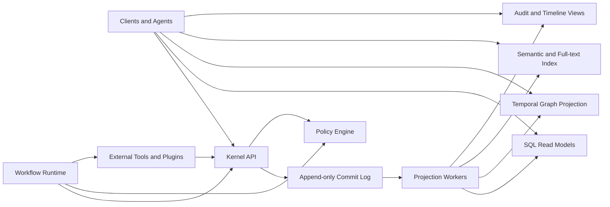
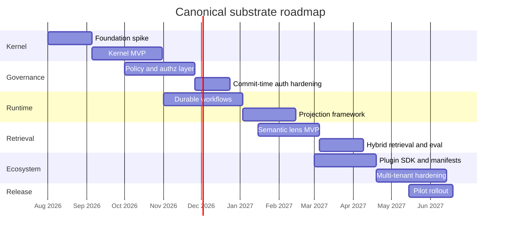

# Designing a Production-Ready Canonical Knowledge and Event Substrate for Agents

## Executive summary

A production-ready “canonical knowledge/event substrate” is feasible, but it should **not** begin as a brand-new database engine. The most practical path is to build a small, opinionated **kernel** around four guarantees—append-only commits, bitemporal facts, policy-checked writes, and replayable execution—and then treat everything else as **derived runtime** or **plugins**. That recommendation follows directly from the strengths of event sourcing and CQRS, bitemporal databases such as XTDB, immutable fact stores such as Datomic, Git’s object/reference model, and durable workflow runtimes such as Temporal. In all of those systems, the winning pattern is a minimal durable core plus many disposable, rebuildable projections. citeturn9search0turn9search1turn8search4turn20search4turn28view0turn7search7

The central design decision should be this: **the source of truth is a canonical commit log of typed envelopes, not a vector index, not a graph index, and not a chat transcript**. Graphs, tables, timelines, search indexes, agent memories, and RAG stores should be treated as **materialized lenses** over that log. This matches the direction of recent agent-memory research. ActiveGraph’s “The Log is the Agent” explicitly makes the append-only log primary and the graph a deterministic projection; Microsoft GraphRAG similarly separates an indexing pipeline from query-time retrieval structures; Graphiti/Zep treats temporal graph memory as an evolving derived structure with provenance and hybrid retrieval. citeturn25view0turn32view0turn32view1turn33view0turn33view2

The most important architectural balance is **universal envelope, explicit semantic kinds**. OpenFGA’s guidance is highly relevant here: model the domain, not a meta-model. In practice, that means the kernel can remain universal—every change is an envelope in one log—but plugin-defined kinds should be explicit and meaning-bearing, such as `task.created`, `policy.boundary.updated`, `artifact.versioned`, or `embedding.generated`. A completely generic “entity/edge/property can represent anything” model becomes hard to audit, slower to evaluate, and harder to evolve safely. citeturn22view0

RAG belongs in this system, but **only as a pluggable derived lens**. Semantic embeddings and vector retrieval are useful, but they should not become the canonical store, because vector indexes are vulnerable to indexing drift, stale access control, poisoning, and embedding-layer weaknesses. OWASP’s 2025 LLM guidance explicitly flags sensitive information disclosure and vector/embedding weaknesses as first-class risks. The correct posture is therefore: canonical facts and permissions first; semantic indexes second; authorization enforced both at query time and at durable effect time. citeturn18search0turn17search1turn24view0turn6search1

If budget and team constraints are open, the best default stack for the **first production version** is usually: **PostgreSQL + JSONB + logical replication + pgvector + Temporal + OpenFGA or Cedar**, with optional Neo4j or OpenSearch where graph traversal or large-scale hybrid retrieval justifies the extra operational surface. PostgreSQL already gives flexible JSONB documents and logical replication; pgvector keeps embeddings transactionally close to source data; Temporal provides durable, replayable execution and retry semantics; OpenFGA/Cedar externalize fine-grained authorization into data and schemas. More specialized alternatives—XTDB for strong bitemporality, or EventStoreDB/Kurrent for event-native storage—are excellent if temporal correctness or event-native ergonomics dominate from day one. citeturn16search1turn15search1turn12search0turn7search7turn0search15turn4search0turn8search4turn27search8

A realistic roadmap to production is about **nine to twelve months** for a senior team if the goal includes multi-tenancy, plugin isolation, fine-grained auth, durable agents, hybrid retrieval, and operational hardening. The hard parts are not CRUD, but **authorization semantics, replay determinism, projection correctness, tenant isolation, and migration discipline**. Those should be designed first and tested continuously. citeturn7search21turn29search18turn6search1turn17search1

## Architectural foundations

The architecture should borrow selectively from several mature traditions rather than copying any one of them wholesale. **Event sourcing** provides the right write model: every mutation is recorded as an append-only event, and current state is computed by replay or projection. Azure’s event sourcing and CQRS guidance is explicit that the event store can be the single source of truth while separate read models serve different query needs. citeturn9search0turn9search1

**Bitemporality** is worth making first-class from the start. XTDB shows why: “system time” captures when the system learned something, while “valid time” captures when that thing was true in the real world. That split is extremely valuable for agent systems because user approvals, delayed syncs, backfilled imports, and retrospective corrections are normal, not edge cases. A substrate for agents and governance should therefore expose both dimensions directly in the canonical envelope, instead of hiding them behind ad hoc `updated_at` columns or snapshot tables. citeturn8search0turn8search4turn8search5

**Immutable facts with provenance** are another crucial ingredient. Datomic’s model is especially instructive: it stores immutable atomic facts, supports `as-of` and `history` views, and reifies transactions so that provenance can itself be attached as data. This is a strong pattern for an agentic substrate because “who/what/why caused this change” should never be an afterthought. W3C PROV provides a complementary provenance vocabulary centered on entities, activities, and agents, which maps cleanly onto “thing, act, actor” style designs. citeturn0search4turn20search2turn20search6turn5search2turn5search5

**Git-like versioning** should influence branch and commit semantics, not storage internals. Git’s core model separates immutable objects from mutable references. Commits point to trees and parents; references such as branches and tags name those immutable objects. That suggests a clean substrate design: store immutable commits and envelopes permanently, while branches, workspaces, approvals, and environment pointers stay mutable as refs. Cheap forking, auditability, and rollback come from the object/ref split, not from complex runtime magic. citeturn28view0turn5search1

**Durable execution** is the right execution model for agents that can run for seconds, hours, or days. Temporal’s documentation is blunt about why: workflows must resume after crashes, activities may be retried, event history is durable, and side-effecting activities should be idempotent because execution is at-least-once at the activity layer. That makes durable workflows a much better fit than ephemeral “agent loops” if the system is expected to orchestrate approvals, leases, budgets, external tools, and resumable multi-step reasoning. citeturn7search7turn7search21turn7search2turn7search16turn7search14

The final foundational principle is **policy as data, enforced at commit time**. OpenFGA and Cedar both externalize authorization into typed models, tuples, entities, and schemas instead of burying it in application code. The new “Commit-Time Authorization for LLM Agents” paper sharpens the requirement for agent systems: a durable effect is only authorized if the evidence that justified it is still fresh and valid at the commit boundary. That means plan-time approval is not enough. The substrate should therefore authorize **reads at query time** and **effects again at commit time**. citeturn0search15turn4search0turn4search3turn6search1

## Comparative analysis of existing systems and papers

The table below compares the most relevant systems and papers to your target design. The key takeaway is that no single existing system provides the exact combination you want. The substrate you are designing is closest in spirit to **ActiveGraph’s log-first research**, but it should borrow operational pieces from **Temporal**, temporal semantics from **XTDB**, immutable-fact semantics from **Datomic**, retrieval lessons from **GraphRAG** and **Graphiti/Zep**, and governance from **OpenFGA/Cedar**. citeturn25view0turn7search7turn8search4turn20search4turn32view1turn33view2turn0search15turn4search0

| System or paper | Core abstraction | Strengths most relevant here | Gaps relative to your target | What to borrow | Sources |
|---|---|---|---|---|---|
| Datomic | Immutable atomic facts and reified transactions | Strong immutability, historical views, transaction provenance, database values as time-filtered “checkouts” | Not an agent runtime; not bitemporal in the XTDB sense; no native plugin/runtime model | Immutable fact model; transaction provenance; time-filtered views | citeturn0search4turn20search2turn20search5turn20search6 |
| XTDB | Bitemporal, immutable SQL database | First-class system time and valid time; automatic historical versioning; compliance-friendly time travel | Not an agent runtime; plugin and policy layers are external | Bitemporal envelope design; correction/backfill semantics | citeturn8search0turn8search4turn8search5 |
| Mem0 | Long-term conversational memory layer | Strong focus on extracting, consolidating, and retrieving salient memory with strong benchmark results | Memory-centric, not a canonical substrate; governance/versioning/resources are secondary | Memory extraction and consolidation as derived services | citeturn26view0 |
| Zep and Graphiti | Temporal context graph for agent memory | Temporal facts, provenance to episodes, hybrid semantic + keyword + graph retrieval, incremental updates | Still focused on memory/retrieval, not full canonical governance kernel | Temporal graph projection; episode provenance; hybrid retrieval patterns | citeturn26view1turn33view0turn33view1turn33view2 |
| Microsoft GraphRAG | Graph-based indexing and retrieval over corpora | Strong retrieval/indexing decomposition; entities, relationships, communities, summaries, vector outputs; multiple query modes | Built around corpora indexing, not canonical writes, governance, or durable agents | Treat semantic and graph retrieval as rebuildable derived projections | citeturn32view0turn32view1turn32view2 |
| Temporal | Durable workflow execution | Durable event history, replay, retries, long-running orchestration, idempotent activity guidance | Not a knowledge substrate or policy system | Durable agent runtime, retries, signals, workflow leasing patterns | citeturn7search7turn7search21turn7search2turn7search12 |
| ActiveGraph paper 2026 | Append-only log projected into a reactive graph | Closest conceptual match: log-first, deterministic projection, replay, forking, lineage | Research-stage architecture, not a complete enterprise platform | Log-first worldview; deterministic replay contract; branch/fork semantics | citeturn25view0 |
| OpenFGA and Cedar | Externalized fine-grained authorization as data and schema | Typed auth models, tuples/entities, schema validation, immutable model versions, RAG authorization patterns | Authorization only; must be integrated with commit semantics and substrate IDs | Policy-as-data, model versioning, least-privilege checks, testable auth | citeturn0search15turn24view0turn29search0turn4search0turn4search3turn4search22 |

One especially important lesson from OpenFGA applies beyond authorization: **do not collapse the entire product into a single over-generic meta-model**. OpenFGA explicitly warns that modeling “anything” with a generic abstraction harms clarity, performance, and evolution, and recommends modeling explicit domain types instead. For your substrate, that means the kernel may remain universal, but plugins should publish concrete semantic kinds and relation types. citeturn22view0

## Recommended reference architecture

The substrate should be organized into **kernel**, **runtime**, and **plugins**.

The **kernel** is the only truly sacred layer. It owns tenant and namespace identity, append-only commit storage, branch refs, bitemporal clocks, canonical envelope validation, provenance links, auth policy attachment, blob references, and deterministic replay boundaries. It does **not** own semantic search, graph traversal, or agent prompts. The kernel should be small enough that you can specify its invariants in a test suite and replay it from scratch. That is the same architectural move seen across event sourcing, Git’s object model, and ActiveGraph’s log-first design. citeturn9search0turn28view0turn25view0

The **runtime** is where automation happens. It ingests commits, builds projections, executes workflows, manages leases, enforces budgets, and keeps derived services such as vector indexes and graph stores current. Temporal is the cleanest fit here because it gives durable workflows, resumability, signals/updates, retries, and event-history-backed replay, all of which are valuable for long-running agents and projection rebuilds. Managed workflow services such as AWS Step Functions or Google Cloud Workflows are workable alternatives when you want cloud-native orchestration rather than a general durable execution platform. citeturn7search7turn7search21turn31search1turn30search5

The **plugin** layer should define semantics, not persistence primitives. A plugin should be able to contribute semantic kinds, projection definitions, UI lenses, tools, migrations, and policies. The best manifest design borrows from three proven ecosystems: VS Code’s manifest-driven activation and contributions, GitHub Apps’ least-privilege permissioning, and MCP’s typed tool/resource/prompt contracts. That yields a plugin model that is declarative, reviewable, capability-scoped, and machine-auditable. citeturn11search0turn11search6turn11search2turn11search12turn10search5turn10search10turn10search19

The canonical write model should be a **typed envelope** with at least these fields: stable ID, semantic kind, schema version, tenant, subject, branch/ref, valid-time interval, recorded-at timestamp, parent commit(s), provenance, auth context, optional blob refs, optional embedding/vector metadata, and opaque typed payload. That structure is the synthesis of Datomic-style immutable facts, XTDB-style bitemporal timestamps, Git-style parentage, and PROV-style lineage. citeturn20search4turn8search4turn28view0turn5search5

The projection strategy should follow one hard rule: **all projections are disposable**. Read models, graph projections, search indexes, vector stores, recommendation tables, and agent memories must be rebuildable from the canonical log. That is exactly how event sourcing/CQRS expect read models to behave, and it is also how GraphRAG describes its indexing pipeline: the pipeline extracts entities, relationships, claims, summaries, and embeddings into query-oriented artifacts separate from the input corpus. citeturn9search1turn32view0turn32view1

That same rule explains where RAG belongs. The semantic index should be a **derived projection** over canonical envelopes and artifacts. GraphRAG and Graphiti both show why hybrid retrieval matters—semantic similarity alone is weak for multi-hop, temporal, and structured questions—but neither pattern should become the primary write model. By making embeddings, graph edges, keyword indexes, and community summaries derived artifacts, you preserve rebuildability and contain the security impact of vector-layer weaknesses. citeturn32view1turn33view0turn33view2turn17search1

Agent execution should be handled as **durable workflows over canonical state**. A useful mental model is: the agent reasons in the workflow layer, reads through authorized projections, emits proposed commits, and only produces durable side effects after commit-time authorization succeeds. Activities that touch the outside world should use idempotency keys; workers should acquire short leases over work items; and every delegation branch should carry explicit budget envelopes for token spend, wall-clock, and external side-effect count. Temporal’s at-least-once activity model makes those controls operationally necessary rather than optional. citeturn7search2turn7search16turn7search14turn6search1

A compact reference architecture looks like this:



This split is what keeps the system both extensible and governable: **the log is stable; the runtime is replaceable; the plugins are optional**. citeturn25view0turn9search1turn7search7

## Implementation details and stack options

The most pragmatic stack depends on whether you want to optimize first for **operational simplicity**, **temporal correctness**, or **event-native ergonomics**. The table below summarizes good options.

| Layer | Strong default | When it is best | Notable trade-off | Sources |
|---|---|---|---|---|
| Canonical store | PostgreSQL + JSONB | Best first production choice when you want one boring, well-understood ACID store with flexible documents | You must build some temporal/event conventions yourself | citeturn16search1turn15search1 |
| Canonical store | XTDB | Best if bitemporality and historical correctness are primary requirements from day one | Smaller ecosystem than PostgreSQL; different operational posture | citeturn8search4turn8search5 |
| Canonical store | EventStoreDB and Kurrent | Best if the team already thinks in streams and wants event-native append/read patterns | Read models must be projected elsewhere | citeturn27search8turn27search1turn27search7 |
| Vector retrieval | pgvector | Best when embeddings should live transactionally near operational data | Not the best choice for massive multi-index search workloads | citeturn12search0 |
| Vector and hybrid search | OpenSearch | Best for large-scale hybrid keyword + vector search and operational query analytics | More infrastructure and more index ops work | citeturn13search0turn13search9 |
| Graph projection | Neo4j | Best when relationship traversal and graph-native queries matter to product experience | Extra datastore to operate and keep in sync | citeturn12search2turn14search0 |
| Workflow runtime | Temporal | Best fit for long-running agents, retries, replay, signals, and resumable orchestration | Additional platform to operate and learn | citeturn7search7turn7search21turn7search2 |
| Workflow runtime | AWS Step Functions or Google Workflows | Good managed alternatives for service orchestration and cloud-native workflows | Less natural for general agent-runtime ergonomics than Temporal | citeturn31search1turn30search5 |
| Authorization | OpenFGA | Best when relationship-based auth and object-level sharing are central | External service and tuple model must be integrated carefully | citeturn0search15turn24view0turn29search0 |
| Authorization | Cedar | Best when you want policy language + schema validation embedded into your own services or managed via AVP | You must design entity graph and policy lifecycle carefully | citeturn4search0turn4search3turn4search6 |

For most greenfield builds, the recommended first stack is:

- **PostgreSQL + JSONB + logical replication** for canonical envelopes and outbox/CDC.
- **pgvector** for initial semantic retrieval.
- **OpenSearch** only if hybrid retrieval volume or search analytics outgrow PostgreSQL.
- **Temporal** for agent and projection orchestration.
- **OpenFGA** for relation-heavy sharing and hierarchical access; optionally **Cedar** if you want a policy language layer for local evaluation and policy validation.
- **Neo4j** only if graph exploration becomes product-critical rather than just technically interesting. citeturn16search1turn15search1turn12search0turn7search7turn0search15turn4search0turn14search0

A minimal envelope schema in TypeScript could look like this:

```ts
export type SemKind =
  | "task.created.v1"
  | "task.updated.v1"
  | "document.ingested.v1"
  | "policy.boundary.updated.v1"
  | "embedding.generated.v1"
  | "agent.effect.requested.v1"
  | "agent.effect.committed.v1";

export interface CanonicalEnvelope<TPayload = unknown> {
  id: string;                     // stable envelope id
  kind: SemKind;                 // semantic kind
  schemaVersion: number;         // payload schema version
  tenantId: string;
  namespace: string;             // project/workspace/plugin scope
  subjectId: string;             // primary entity this concerns
  commitId: string;              // immutable commit object id
  parentCommitIds: string[];     // Git-like lineage
  branchRef: string;             // mutable ref, e.g. "main" or "draft/abc"
  recordedAt: string;            // system time
  validFrom: string;             // valid time lower bound
  validTo?: string | null;       // valid time upper bound
  actor: {
    type: "user" | "agent" | "plugin" | "system";
    id: string;
    runId?: string;
  };
  provenance?: {
    sourceEnvelopeIds?: string[];
    sourceBlobIds?: string[];
    sourceUris?: string[];
  };
  authContext: {
    policyVersion: string;
    authzWitness?: string;       // witness used for commit-time authorization
    classification?: "public" | "internal" | "restricted" | "secret";
  };
  idempotencyKey?: string;
  payload: TPayload;
}
```

That envelope intentionally fuses **Git-like lineage**, **XTDB-like valid/recorded time**, and **Datomic/PROV-style provenance**. citeturn28view0turn8search4turn20search2turn5search5

A minimal kernel API should stay small:

```ts
export interface CommitRequest<TPayload = unknown> {
  branchRef: string;
  expectedHead?: string; // optimistic concurrency
  envelopes: CanonicalEnvelope<TPayload>[];
}

export interface CommitResult {
  commitId: string;
  newHead: string;
  acceptedEnvelopeIds: string[];
  rejected: Array<{
    envelopeId: string;
    reason: "schema" | "authz" | "stale-witness" | "conflict" | "budget";
    detail: string;
  }>;
}

export interface KernelApi {
  commit(req: CommitRequest): Promise<CommitResult>;
  getHead(branchRef: string): Promise<string>;
  readTimeline(subjectId: string, asOf?: string, validAt?: string): Promise<CanonicalEnvelope[]>;
  forkBranch(fromRef: string, newRef: string): Promise<void>;
  rebuildProjection(name: string, fromCommitId?: string): Promise<void>;
}
```

A plugin manifest should be declarative and capability-scoped:

```ts
export interface PluginManifest {
  name: string;
  version: string;
  engineRange: string;
  activationEvents: string[]; // inspired by VS Code
  semanticKinds: Array<{
    kind: string;
    jsonSchema: Record<string, unknown>;
  }>;
  permissions: {
    readKinds: string[];
    writeKinds: string[];
    toolScopes: string[];
    externalHosts: string[];
  };
  projections?: Array<{
    name: string;
    inputKinds: string[];
    output: "sql-view" | "graph" | "vector-index" | "materialized-json";
  }>;
  tools?: Array<{
    name: string;
    description: string;
    inputSchema: Record<string, unknown>;
  }>;
  migrations?: Array<{
    fromVersion: string;
    toVersion: string;
    kindUpcasters: string[];
  }>;
}
```

That contract draws on manifest-driven extension systems, least-privilege integration permissioning, and typed tool contracts. citeturn11search6turn11search0turn11search2turn11search12turn10search5turn10search19

Migration and versioning should follow five rules. **First**, never mutate canonical commits. **Second**, evolve payloads with explicit upcasters, not in-place rewrite jobs. **Third**, version policy models immutably—OpenFGA already treats new auth models as new versions. **Fourth**, projection schema changes should trigger rebuilds rather than retroactive canonical surgery. **Fifth**, embedding and graph indexes should be considered cache-like rebuild targets, because GraphRAG itself documents config and migration steps across versions. citeturn29search0turn32view1

## Verification, security, and operations

The fastest way to derail this project is to underinvest in **invariants**. A canonical substrate is only valuable if replay, authorization, and projection semantics are trustworthy. These tests should exist before the plugin ecosystem does. OpenFGA’s own documentation emphasizes testing authorization models before deployment, while Temporal and event-sourced systems make idempotency and replay central correctness properties. citeturn29search18turn7search16turn9search0

Here is a concrete kernel test suite that I would treat as mandatory:

| Test | What it validates | Pass condition | Why it matters | Sources |
|---|---|---|---|---|
| Deterministic replay | Rebuilding from commit `0..N` yields the same canonical subject state and projection inputs every time | Replayed hash equals original hash | Core promise of event sourcing and ActiveGraph-style replay | citeturn9search0turn25view0 |
| Bitemporal correctness | `recordedAt` and `validFrom/validTo` are handled independently | “Known then” and “true then” queries return expected different answers | Required for corrections, backfills, delayed syncs | citeturn8search0turn8search4 |
| Commit-time authorization | A write approved on stale evidence is rejected at commit | Stale witness causes rejection even if earlier read succeeded | Prevents durable effects from outdated authority | citeturn6search1 |
| Workflow idempotency | Retried activity does not duplicate external side effects | Duplicate delivery with same idempotency key produces one durable effect | Temporal-style retries make this non-negotiable | citeturn7search2turn7search16 |
| Branch isolation | Forked branch mutations do not leak into parent ref until merge | Parent views unchanged until explicit merge commit | Needed for experimentation, human review, and what-if agents | citeturn28view0 |
| Projection rebuild equivalence | Rebuilt projection equals incrementally-maintained projection | Same answer set and ranking inputs for a fixed snapshot | Ensures projections are truly disposable | citeturn9search1turn32view0 |
| Plugin capability isolation | Plugin cannot read/write kinds or call tools outside manifest | Unauthorized call is denied and logged | Required for marketplace safety | citeturn11search2turn11search12 |
| RAG authorization filtering | Unauthorized documents never enter LLM context | Batch check or pre-filter removes all forbidden docs | Prevents retrieval-layer data leaks | citeturn24view0turn18search0 |
| Budget and lease enforcement | Worker overrun or budget exhaustion stops effectful execution | Expired lease or depleted budget prevents commit | Prevents runaway agents and dueling workers | citeturn7search21turn7search14 |

Security and privacy deserve special treatment because RAG and agent systems create new leakage paths. OWASP’s 2025 LLM guidance explicitly identifies **sensitive information disclosure** and **vector and embedding weaknesses** as major risks, and OpenFGA’s RAG authorization guide shows the concrete control pattern: either pre-filter retrieval or batch-check candidates before passing context to the model. In a substrate like yours, every derived artifact should carry a security label and auth scope, and the runtime should regard the LLM context window itself as a privileged sink. citeturn18search0turn17search1turn24view0

Operationally, three concerns dominate. **First**, projection lag: because read models and indexes are derived, you need SLOs for freshness and replay completion. **Second**, hot streams and high-fan-out subjects: some tenants, agents, or projects will concentrate activity and require partitioning by tenant/namespace/subject. **Third**, rebuild economics: graph and vector indexes must be rehydratable from canonical data, but you still need checkpoints, backfill windows, and observability around rebuild duration. PostgreSQL logical replication, Temporal event histories, and event-native stores such as EventStoreDB all help here, but they do not remove the need to instrument lag, retries, and dead-letter paths explicitly. citeturn15search1turn7search21turn27search7

The correct operational motto is simple: **store intent once, derive many times, verify continuously**. That is the only sustainable way to support agents, plugins, governance, and RAG without drifting into an un-auditable knot of side stores. citeturn9search1turn25view0

## Roadmap

The roadmap below is an implementation estimate, not a vendor quote. It is inferred from the number of subsystems that must become correct at the same time: append-only commits, bitemporal queries, durable workflows, authorization models, projection pipelines, and retrieval safety. Those are all individually mature patterns, but their combination is the real project. citeturn9search0turn8search4turn7search7turn29search0turn32view0

| Phase | Scope | Suggested team | Estimated effort | Primary risks |
|---|---|---|---|---|
| Foundation spike | Canonical envelope, commit object model, branch refs, bitemporal query API, invariants doc | 2–3 senior engineers + 1 architect | 3–5 weeks | Over-generalizing the model too early |
| Kernel MVP | Append-only commits, replay, branch/fork, optimistic concurrency, provenance, blob refs | 3–4 engineers | 6–8 weeks | Replay determinism bugs; envelope sprawl |
| Governance layer | OpenFGA or Cedar integration, policy versioning, commit-time auth, RAG-safe reads | 2 engineers + security lead | 6–8 weeks | Stale-witness edge cases; policy drift |
| Runtime and projections | Temporal workflows, projection workers, SQL timelines, audit views, graph/vector rebuild APIs | 3–4 engineers | 8–10 weeks | Retry/idempotency mistakes; projection lag |
| Retrieval lens | Embedding generation, hybrid retrieval, auth filtering, index rebuild tooling, query eval harness | 2–3 engineers + applied ML | 6–8 weeks | Leakage, weak relevance, index staleness |
| Plugin SDK | Manifest schema, capability isolation, migrations, packaging, developer tooling | 2–3 engineers | 6–8 weeks | Unsafe plugins; migration incompatibility |
| Hardening | Multi-tenant ops, observability, chaos/replay tests, DR, quota/budget controls, support tooling | Whole team | 8–12 weeks | Operational complexity; runaway cost |
| Production rollout | Pilot tenants, staged policy rollout, backfill/import tooling, docs, on-call readiness | Whole team | 4–6 weeks | Real-data migration surprises |

In practice, that stacks up to about **nine to twelve months** for a serious first production release with a team of roughly **six to eight senior engineers**, plus dedicated product and security support. A smaller team can do it, but usually only by delaying the marketplace/plugin ambitions or treating graph/RAG as later phases rather than launch-critical. citeturn7search7turn24view0turn17search1

A sensible sequence looks like this:



The biggest strategic risk is building too much “universal substrate” before proving a few high-value workflows. OpenFGA’s warning against meta-modeling is relevant again here: the kernel should be universal, but product value should be validated through **specific** semantic kinds and concrete use cases—document memory, task lineage, policy-governed agent execution, and RAG-safe retrieval—rather than by trying to make the first release represent literally everything. citeturn22view0

The best end-state is not “a database that can store anything.” It is **a small canonical kernel that can safely absorb new meaning without losing replayability, provenance, or control**. If you achieve that, RAG, graph memory, workflows, plugins, and governance all become compatible lenses over one stable substrate rather than separate systems fighting each other. citeturn25view0turn9search1turn24view0